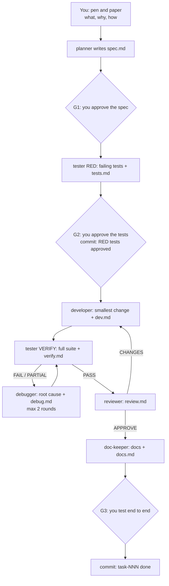

# The Vibe Coding Cookbook

*How to build real software with an AI coding agent without losing control of it.*

Draft, September 2026. Tools and features change every few weeks: every product claim below was checked against the
vendor's documentation on 2026-09-25, and the sources are listed at the end.

## How to read this

This cookbook is for colleagues who want to use a coding agent (Claude Code, GitHub Copilot, Codex, Cursor) for more
than autocomplete: to let it write most of the code while you keep control of what gets built. It follows the order
I work in:

| Part | Question it answers |
|---|---|
| [0. Start with a pen and paper](#0-start-with-a-pen-and-paper) | What do I want, before I open the agent? |
| [1. Set up your environment](#1-set-up-your-environment-who-owns-what) | What may the agent touch, what stays mine, and how do I undo its mistakes? |
| [2. Set up your workflow](#2-set-up-your-workflow-lay-the-foundation-top-down) | Which documents come first, and in what order? |
| [3. Vibe coding components](#3-vibe-coding-components) | CLAUDE.md, memory, skills, subagents, agent teams, MCP |
| [4. Running the workflow](#4-running-the-workflow) | What does one task look like, from spec to commit? |
| [5. Guardrails](#5-guardrails-settings-and-hooks) | How do I enforce the rules instead of hoping? |
| [6. Principles](#6-principles) | The short version |
| [7. Your turn](#7-your-turn-hand-it-to-your-agent) | How do I set this up in my own project, with my own agent? |
| [Appendix](#appendix) | Glossary, starter prompts, sources |

Most parts end with an **In other agents** box: what the same idea is called in GitHub Copilot, OpenAI Codex and
Cursor.

## What "vibe coding" means here

Andrej Karpathy coined the term in February 2025 for a style where "I "Accept All" always, I don't read the diffs
anymore", and he called it "not too bad for throwaway weekend projects"
([post](https://x.com/karpathy/status/1886192184808149383)). Simon Willison's short definition: "building software
with an LLM without reviewing the code it writes" ([post](https://simonwillison.net/2025/Mar/19/vibe-coding/)).

That is fine for a prototype, a throwaway script or a weekend experiment with no client data, no secrets and nothing
that is charged per use. It is not how you build something a client will run. For that, Karpathy now uses another
name, **agentic engineering**: the same agents, "except with more oversight and scrutiny"
([post](https://x.com/karpathy/status/2019137879310836075)).

I kept "vibe coding" in the title because it is the word everyone knows. What this cookbook teaches is agentic
engineering: the agent writes most of the code, and you keep the quality bar. Think of it as what Karpathy calls an
autonomy slider. The lower the stakes, the more you let go; the higher the stakes, the more gates, tests and review
you add. The FULL, LIGHT and TRIVIAL paths in Part 4 are three positions on that slider.

## The worked example: ServiceFlow AI

Every example in this cookbook is real. It comes from **ServiceFlow AI**, an aftersales intelligence layer we are
building for MSL Motor Group's Mercedes-Benz service centres in Ireland. It rebuilds each repair order's lifecycle
from events, finds where time and money are waiting, and suggests the next action to the Service Advisor. The stack
is a Next.js frontend, a Python/FastAPI backend with an append-only SQLite event store, and Docker Compose for the
demo. Most of its code is written by agents following the workflow in Part 4.

The project is useful as an example because it has every component this cookbook talks about:

| Component | Where it lives in the repository | Part |
|---|---|---|
| Product spec, demo brief, PRP | `docs/product/` | 2 |
| Architecture and decisions (4 ADRs) | `docs/architecture/`, `docs/architecture/decisions/` | 2 |
| Lessons learned | `docs/workflow/LESSONS_LEARNED.md` | 2, 5 |
| CLAUDE.md (132 lines) | `CLAUDE.md`, `frontend/CLAUDE.md` | 3.1 |
| Rules | `.claude/rules/tests.md`, `.claude/rules/ui.md` | 3.2 |
| 12 skills | `.claude/skills/` | 3.3 |
| 6 role subagents | `.claude/agents/` | 3.4 |
| MCP servers | `.mcp.json` | 3.6 |
| Tasks, one folder each | `tasks/NNN-slug/` | 4 |
| Issue catalog | `docs/issues/` | 4.4 |
| Permissions and hooks | `.claude/settings.json`, `.claude/hooks/guard.py` | 5 |

Excerpts are quoted verbatim with their path and line numbers (`path:lines`). `…` marks a cut inside a block; excerpts
labelled "(trimmed)" may also leave out whole rows of a table or list.

## 0. Start with a pen and paper

Every workflow in this cookbook starts before you open the agent. Decide what you want to do now: which task, which
feature, what "finished" looks like and roughly how you want it built. If you skip this step, the agent will steer
you away from your own train of thought with thousands of lines of code and over-complex solutions you never asked for.
It is very easy to get lost in what your agent is developing.

Five lines on paper are enough. I write them before every task:

```text
Goal:          what changes for the user or the business (one sentence)
Done when:     2–4 checks I can see with my own eyes (a screen, a number, a passing test)
Out of scope:  what the agent must NOT touch or build this time
Approach:      how I think it should be built, and what already exists that we can reuse
How I check:   the command I run, the page I open, the test I read
```

If you cannot fill in "Done when", you are not ready to prompt. Talk to the business, read the notes again, or ask
the agent to interview you first (the `grill-me` skill, Part 3).

**The digital equivalent is Plan mode.** In Claude Code, press **Shift+Tab** until the status line shows plan mode.
The agent can read files, run exploratory commands and ask questions, but its edits stay blocked until you approve the
plan. (The exception is a terminal session started with bypass permissions available: there, plan mode is only an
instruction.) Use it for anything bigger than a one-line change. It does not replace the paper: the paper holds
*your* intent, the plan holds the agent's interpretation of it, and you compare the two.

> **In other agents.** Plan mode is standard now.
> - **Copilot:** in VS Code, type `/plan` to put a Copilot session in Plan mode, or pick the built-in Plan agent in a
>   Local session, which researches without editing and hands off with "Start Implementation". In Copilot CLI,
>   Shift+Tab cycles to plan mode.
> - **Codex:** `/plan` asks for an execution plan before implementation. For a chat that cannot edit at all, set
>   `/permissions` to read-only.
> - **Cursor:** Plan Mode with Shift+Tab (IDE) or `/plan` (CLI), then Build.

## 1. Set up your environment: who owns what

The first decision is not which model or which tool. It is **what the agent may change on its own and what stays
with you.** This is the critical component of the whole setup.

### 1.1 The ownership split

| You own (the agent changes it only with your permission, or you do it yourself) | You delegate (the agent writes, you steer and check) |
|---|---|
| DevOps: CI/CD workflows, deployment files, infrastructure code | Product requirements plans (PRPs), drafted from your inputs |
| `.env` and every other file with credentials | Task specs and acceptance criteria |
| Git history: commits, merges, pushes | Issue records and the lessons they teach |
| New dependencies (every install) | Tests, written by a separate tester agent |
| The agent's own setup: `CLAUDE.md`, `.claude/`, `.mcp.json` | Skills and memory |
| Architecture decisions (the agent drafts options, you decide) | Documentation, kept current by a doc-keeper agent |
| Contracts that someone outside the team gave you (brand, API, data) | Most of the code |
| Final acceptance of every task | |

Why delegate most of the code? Because it is impossible to read hundreds of thousands of lines of code yourself.
Agents write thousands of lines in minutes, and our jobs are hectic and dynamic. I do not validate every line, and I
do not think you should try.

But "not reading every line" does not mean "not checking". You validate **behaviour**, not lines:

- tests written *before* the code, by a different agent, that the coding agent cannot edit;
- an independent review agent that re-runs everything and reads the diff;
- static checks (linters, import-boundary rules, a design check) that run on every change;
- hooks that block the agent from touching what you own;
- your own end-to-end check before you accept the task.

Parts 4 and 5 show each of these on a real project.

**Read by risk, not by volume.** Not every line deserves the same attention. Read the code yourself where a mistake
is expensive or hard to notice: money and pricing, security and authentication, client data, and the core business
rules. Let the tests and the reviewer carry the boilerplate, the UI plumbing and the glue code. In ServiceFlow that
means `backend/domain/`, where prices, VAT and SLA rules live, and the one bug the reviewer caught in task 002
(Part 4.2) was indeed a VAT total.

One rule has no exceptions: never ship code you could not explain to someone else. Simon Willison: "I won't commit any
code to my repository if I couldn't explain exactly what it does to somebody else"
([source](https://simonwillison.net/2025/Mar/19/vibe-coding/)). When you need to understand code you did not write,
ask the agent to walk you through it
([Willison's prompt](https://simonwillison.net/guides/agentic-engineering-patterns/linear-walkthroughs/)):

```text
Read the source and then plan a linear walkthrough of the code that explains how it all works in detail
```

### 1.2 Write the split down, then enforce it

In ServiceFlow AI, the split lives in two places. First, as a table in `CLAUDE.md` that tells every agent who writes
which artifact:

`CLAUDE.md:60-77` (trimmed)
```markdown
## Canonical locations
| Artifact | Path | Written by |
|---|---|---|
| Product spec, demo brief, PRPs | `docs/product/` (`PRP-NNN-slug.md` for PRPs) | main thread, doc-keeper |
| UI contract and reference boards (frozen) | `frontend/DESIGN.md`, `frontend/design/reference/` | main thread, only with the user's approval |
| Backend source (by layer) | `backend/domain/`, `backend/application/`, `backend/adapters/`, `backend/api/` | developer, debugger |
| Decisions (ADRs) | `docs/architecture/decisions/NNNN-slug.md` + `README.md` index | main thread with the user; doc-keeper indexes |
| Issues | `docs/issues/ISSUE-CATALOG.md` (index), `docs/issues/ISSUE-NNN-slug.md` | tester, developer, debugger, doc-keeper, main |
| Task spec | `tasks/NNN-slug/spec.md` | planner (main thread for LIGHT) |
| Tests and test infrastructure | `backend/tests/`, the frontend's test folders | tester (new test files: also developer, debugger) |
| Claude Code setup | `CLAUDE.md` files, `.claude/`, `.mcp.json` | main thread, with the user's approval |
```

Second, as rules the agent cannot talk its way around. Prose in `CLAUDE.md` is guidance; the agent can forget or
misread it. Permissions in `.claude/settings.json` are enforced by Claude Code itself:

`.claude/settings.json:33-46, 57-63` (trimmed; each rule is repeated for `PowerShell(...)`)
```json
"deny": [
  "Read(./.env)",
  "Read(./.env.local)",
  "Read(./.env.*.local)",
  "Read(./.env.production)",
  "Bash(git push)",
  "Bash(git push *)",
  "Bash(git commit --amend)",
  "Bash(git rebase *)",
  "Bash(git reset --hard *)",
  …
],
"ask": [
  "Bash(git commit *)",
  "Bash(npm install *)",
  "Bash(pip install *)",
  "Bash(uv add *)",
  …
]
```

The agent cannot read the secrets or push, and it asks me before every commit and every install. Part 5 adds the
hooks that protect the rest (the agent's own setup, the frozen design contract, committed tests) and the limits of
deny rules. ServiceFlow has no CI pipeline yet, and its `Dockerfile`s and `compose.yaml` are protected only by the task
gates. If your project has `.github/workflows/` or Terraform, put them on the protected list from day one.

### 1.3 Git is your undo button

AI agents make mistakes: a wrong assumption, a refactor that breaks three other things, a "fix" that deletes the
feature it was meant to repair. So before you let an agent work, make sure you can always get back to the last state
that worked. That way is git, and you set it up before the task, not after the damage.

- **Start clean and commit often.** A commit is a save point. Start every task from a clean `git status`, and commit
  each step that works. Addy Osmani: "Frequent commits are your save points - they let you undo AI missteps and
  understand changes" ([source](https://addyosmani.com/blog/ai-coding-workflow/)). In ServiceFlow, `/task` requires a
  clean `git status` before it starts, and it commits at two gates: when the RED tests are approved and when the task
  is done.
- **Experiment on a branch, never on `main`.** If the experiment fails, you delete the branch and nothing is lost.
- **Know the in-session undo, and its limits.** Claude Code saves a checkpoint at every prompt. `/rewind` (or `Esc`
  twice) restores the code, the conversation or both. But checkpoints do not track files changed through shell
  commands, and edits made by subagents are usually not restored: "Use git to revert them"
  ([checkpointing](https://code.claude.com/docs/en/checkpointing)). In a workflow built on subagents, like the one in
  Part 4, git is the only real undo.

The commands to know:

```bash
git status                 # what changed?
git diff                   # how exactly?
git restore <file>         # throw away uncommitted changes to one file
git stash                  # park all uncommitted changes; "git stash pop" brings them back
git revert <commit>        # undo a commit with a new commit, keeping the history
git reset --hard <commit>  # go back to a known good commit and discard everything after it
```

The last one destroys work, which is why ServiceFlow denies it to the agent (1.2). It is your command, not the
agent's.

> **In other agents.** Every tool can deny and ask; the knobs have different names.
> - **Copilot:** CLI `--allow-tool` / `--deny-tool` (deny beats allow, even with `--allow-all`). VS Code:
>   `chat.tools.edits.autoApprove` (for example `"**/.env": false`) and `chat.tools.terminal.autoApprove`.
>   Organisation content exclusion is not supported in VS Code's agent mode.
> - **Codex:** `sandbox_mode` (`read-only`, `workspace-write`, `danger-full-access`) plus `approval_policy`; `.git`,
>   `.agents` and `.codex` stay read-only; experimental `.codex/rules/*.rules` with allow, prompt or forbidden.
> - **Cursor:** run modes, `.cursor/permissions.json` and `.cursor/sandbox.json`. `.cursorignore` blocks files from Agent,
>   but terminal commands and MCP tools may still read them.

## 2. Set up your workflow: lay the foundation top-down

Work from top to bottom: value first, then requirements, then architecture, then tasks, then code. It is very
important to lay the right foundation, because every later agent reads it.

### 2.1 Ask the agent to create the skeleton

Start an empty repository and give the agent a prompt like this one:

```text
Create the documentation skeleton for a new project. Create only folders and short placeholder files, no code.
- docs/product/            raw inputs, the product spec and PRPs (PRP-NNN-slug.md)
- docs/architecture/       ARCHITECTURE.md (principles + current state) and PROJECT_STRUCTURE.md
                           (one row per directory with its purpose)
- docs/architecture/decisions/   ADRs as NNNN-slug.md, plus a README.md index table
- docs/issues/             ISSUE-CATALOG.md (index table: ID, title, status, area, file)
- docs/workflow/           LESSONS_LEARNED.md (rule, evidence, what enforces it)
- docs/tech-debt/          TECH_DEBT.md (item, why it is debt, cost of leaving it, trigger to fix)
- docs/code-style/         CODE_STYLE.md (only what the linters cannot check)
- tasks/                   one folder per task: tasks/NNN-slug/
- tests/                   empty, mirrors the source layout later
Then write a CLAUDE.md under 100 lines that says what we are building (one paragraph, TBD for now) and
where each of these lives. Show me the tree before you create anything.
```

ServiceFlow covers the same ground, with two differences. Code style and technical debt have no folder of their own:
style is enforced by tools, and debt is recorded where it is found.

| You asked for | Where ServiceFlow keeps it |
|---|---|
| Decisions | `docs/architecture/decisions/` — ADR-0001 to 0004 plus the `README.md` index |
| Technical debt | No folder. The reviewer records it as "Minor" notes in `tasks/NNN/review.md` (the user deferred task 002's M-1 to the pilot); known defects go to the issue catalog |
| Code style | No folder. `ruff` and ESLint configs, `.claude/rules/ui.md`, and `frontend/scripts/check-design.mjs` |
| Tests | `backend/tests/` (mirrors `domain/`, `adapters/`), `frontend/e2e/` |
| Issues | `docs/issues/ISSUE-CATALOG.md` + one `ISSUE-NNN-slug.md` per issue |
| Lessons learned | `docs/workflow/LESSONS_LEARNED.md` |
| Architecture | `docs/architecture/ARCHITECTURE.md` + topic docs (`BACKEND.md`, `DATA.md`, …) |
| Project structure | `docs/architecture/PROJECT_STRUCTURE.md`, imported into `CLAUDE.md` and drift-checked by `guard.py check` |
| Tasks | `tasks/NNN-slug/` with `spec.md`, `tests.md`, `dev.md`, `verify.md`, `review.md`, `docs.md` |
| Product inputs | `docs/product/` |

If your team has no linter for something (naming, logging, error messages), a `CODE_STYLE.md` is worth having.
Anything a tool can check should be a tool, not a paragraph.

### 2.2 Collect every raw input

You need to understand what value you will deliver, which problems the application should solve and what it must do.
Collect everything that exists: user stories, requirements, emails, notes from a call, call transcripts, screenshots
of the current process. Put them in `docs/product/` as they are, translated into one language, with the source and date.

ServiceFlow's spec arrived as a written specification plus its author's commentary in Russian. The specification is
stored verbatim and the commentary is translated:

`docs/product/PRODUCT_SPEC.md:3-4`
```markdown
> **Source:** written by Maks Kampinen, shared on 2026-09-22. Sections 1–24 are verbatim; only the formatting was
> converted to Markdown. Appendix A is an English translation of his commentary (the originals were in Russian).
```
`docs/product/PRODUCT_SPEC.md:806`
```markdown
## Appendix A — Maks's commentary (translated from Russian)
```

### 2.3 Turn the inputs into a PRP

Then give the folder to your agent and ask it to create a **PRP**. The term has two meanings, and both are useful:

- **Product Requirement Prompt** — the original meaning, from Rasmus Widing's PRP framework
  (github.com/Wirasm/prp, formerly `PRPs-agentic-eng`): "PRD + curated codebase intelligence + agent/runbook". A
  classic PRD says *what* to build; a PRP also gives the agent the context it needs to build it (the relevant files,
  patterns, library docs, gotchas) and the steps and checks to follow.
- **Product requirements plan** — how ServiceFlow uses it: one document per milestone that fixes the goal, the
  audience, the scope, the rules and the ordered list of tasks. Every task spec is cut from it.

Here is what that looks like for ServiceFlow's first milestone, a 15-minute CEO demo:

`docs/product/PRP-001-ceo-demo.md:3-6`
```markdown
> **What this is:** the product requirements plan for ServiceFlow's first milestone, the ~15-minute demo for MSL Motor
> Group's leadership ([DEMO_BRIEF](DEMO_BRIEF.md)), built on the real architecture so it carries into the pilot
> ([PRODUCT_SPEC](PRODUCT_SPEC.md)). Decided with the user on 2026-09-24; research facts carry their source and date.
> `/task` specs are cut from §10. Update this file in place when a decision changes.
```

It opens with "must-know facts": the few rules every agent must not miss.

`docs/product/PRP-001-ceo-demo.md:14-15`
```markdown
3. **The LLM never owns business truth** (spec §17): prices, times, states, approvals, parts availability and money
   come from events and deterministic rules. AI text refers to figures only through placeholders the backend fills (§7).
```

A goal tied to a business outcome, not to a feature:

`docs/product/PRP-001-ceo-demo.md:25-26`
```markdown
**Goal:** MSL's leadership recognises a day in their own workshop, sees how ServiceFlow finds waiting time and money
and helps people act on it, and **approves a 90-day pilot at one site** (spec §21, MVP proofs 1–7).
```

And a task table with dependencies, waves that can run in parallel, and a cut rule for when time runs out:

`docs/product/PRP-001-ceo-demo.md:299-302, 328-329, 333` (trimmed)
```markdown
| # | Task | Tier | Depends | Wave | Writes to | Brings |
|---|---|---|---|---|---|---|
| 002 | Engine contract: event types and payloads, append-only SQLite event store, simulated clock, Dublin time, operation catalogue with labour times and prices (sample), VAT per line | MUST | 001 | 1 | backend domain, persistence and clock adapters | Event and pricing contract |
…
**Waves:** 0: 001 · 1: 002, 003 · 2: 004, 006, 015, then 005 once 015 is merged · 3: 007, 008 · 4: 009, 010 ·
5: 011, 012, 014. 013 runs once 006 is merged. Critical path: 001 → 002 → 015 → 005 → 008 → 009.
…
**Cut rule:** if M2 is not reached by day 10, SHOULD and COULD items drop and the remaining days go to rehearsal.
```

Read the PRP line by line. It is short enough to do so, and everything downstream inherits its mistakes.

### 2.4 Make architecture decisions together

Next, make the architectural decisions, and record each one. Do it together with the agent: this is a collaborative
approach. The agent brings options and evidence; you decide. ServiceFlow has a `designing-features` skill for this.
It frames the decision, asks only what blocks it, compares 2–3 options least-code first, and then: "**The user
decides** (AskUserQuestion). Never record a decision the user has not approved."
(`.claude/skills/designing-features/SKILL.md:31`).

The result is a short Architecture Decision Record (ADR). ADR-0002 is 32 lines:

`docs/architecture/decisions/0002-repository-layout-and-clean-architecture.md` (trimmed)
```markdown
# 0002 — Repository layout: frontend/ and backend/ with clean architecture
- Status: accepted
- Date: 2026-09-23 · Decided by: the user

## Context
## Options considered (least code first)
1. One Next.js app with layered `src/` and the API as route handlers — least code for the demo, but …
2. **`frontend/` + `backend/`** — two top-level apps; … Cost: two projects and an API contract.
3. `apps/` + `packages/` workspace monorepo — a shared domain package, but more tooling, …
## Decision
Option 2. Top-level folders are deployable parts named by what they are. …
## Consequences
## Revisit when
The backend ADR prefers Next.js route handlers after all, or frontend and backend need to share code (then consider
a shared package).
```

Note the last section. "Revisit when" says in advance what evidence would change the decision. That keeps a decision
firm today without pretending it is permanent.

### 2.5 Research before you build: don't reinvent the wheel

When you create tasks, ask the agent to research first: find existing solutions, libraries and reference
repositories. You do not need to invent components that already exist. There is a second reason: existing projects
already have proven architectural patterns and library versions that work together. Compatibility is expensive to
discover on your own.

ServiceFlow writes this down as the first non-negotiable:

`CLAUDE.md:22-23`
```markdown
1. **Least code.** The best code is the code never written. Walk the reuse ladder: don't build → existing code →
   built-in → mature package → managed service → new code. …
```

The agent's knowledge is also out of date. Its training stopped months ago, and libraries move fast. So a second rule
makes it check before it relies on memory:

`CLAUDE.md:38-40`
```markdown
6. **Your knowledge is stale.** Before using a third-party API, CLI flag or config key not yet verified in this repo:
   installed version → Context7 → official docs; record URL, version and date (`verifying-library-docs`).
   Registry-check every new package. Never keep a deprecated API "for consistency".
```

This rule exists because of real damage on our previous project:

`docs/workflow/LESSONS_LEARNED.md:63-65`
```markdown
- **Evidence:** a wrong assumption about a Snowflake connector call was baked into fakes, so no test could see the
  bug; behaviour was verified on pandas 2.2.3 while the repo pinned 2.3.3; a deprecated constant was kept "for
  consistency"; agent prompts carried stale facts about the codebase.
```

Context7 (an MCP server, Part 3) is the fastest way to give the agent current, version-specific docs.

### 2.6 Architecture is a live document

Do not expect your architecture to stay fixed. While you develop you will hit issues and bugs, and you will have to
change things. That is why I do not like storing design and architecture as frozen artifacts: it is impossible to
keep them frozen. Architecture should be a live document. ServiceFlow makes this a rule:

`CLAUDE.md:42-43`
```markdown
8. **Docs describe the current state.** Update them in the same task, in place, without dated "update" blocks;
   history lives in git and `tasks/`.
```

A doc-keeper agent runs at the end of every task and edits the architecture docs in place, so the next agent reads
how the system works *now*, not how someone planned it three weeks ago. The history is not lost: it lives in git, in
the task folders and in each ADR.

There is one deliberate exception. `frontend/DESIGN.md` is frozen:

`CLAUDE.md:64`
```markdown
| UI contract and reference boards (frozen) | `frontend/DESIGN.md`, `frontend/design/reference/` | main thread, only with the user's approval |
```

It is frozen because we did not write it: it is the design contract that came with the MSL design package
(ADR-0001), and the agent must not "improve" a client's brand. My rule of thumb: **freeze only what someone outside the team owns.**
Everything the team owns stays alive.

> **In other agents.** Nothing in this part is tool-specific. The folders, the PRP and the ADRs are plain Markdown
> that any agent can read. Point to them from `AGENTS.md` (Part 3.1) so Copilot, Codex and Cursor find them too.

## 3. Vibe coding components

A coding agent is more than a model in a terminal. Around it sit a handful of components you configure once and then
live with: the instructions file, memory, skills, subagents, and tools (MCP servers). This part explains what each
one is, when it loads, and how it looks in a real project.

### 3.1 CLAUDE.md / AGENTS.md: the roadmap

`CLAUDE.md` is the file I would ask every colleague to read line by line, because it shapes everything the agent
does afterwards. It is loaded at the start of every session, and every custom subagent gets it too (the built-in Explore and Plan
agents skip it). A vague or bloated
`CLAUDE.md` produces vague or bloated work across the whole project.

It is a roadmap, not an encyclopedia. It should tell the agent:

- **What we are building**, in two or three sentences, and the product rules that shape the code.
- **Where things live**: which folder holds specs, decisions, issues, tests and code.
- **Which agents and skills to use when.**
- **The project structure** (imported, see below).
- **Environment quirks**: OS, shells, tool versions, anything that has already cost you an hour.

The rule I use: **if I have told the agent the same thing twice, it belongs in `CLAUDE.md`.** Anthropic suggests the
opposite test for every line already there: "Would removing this cause Claude to make mistakes?" If not, cut it
(https://code.claude.com/docs/en/best-practices). Long files get ignored, so keep it under about 200 lines. Ours is
132 lines, and the project hook blocks it above 200.

Here is what the top of ours looks like. It says what the product is and names the one document everything else is
cut from:

`CLAUDE.md:6-11`
```markdown
## Project
ServiceFlow AI is an AI aftersales intelligence and workflow layer for MSL Motor Group's Mercedes-Benz service centres
(Ireland). It rebuilds each repair order's lifecycle from events, finds where time and value are waiting, recommends
the next action, helps Service Advisors carry it out, and measures the financial impact.
- **Stage:** Phase 0. First milestone: a ~15-minute CEO demo (`docs/product/DEMO_BRIEF.md`), planned in
  `docs/product/PRP-001-ceo-demo.md` (story, scope, rules, task order). …
```

The environment section is where the "hour lost" lessons go. Every line below exists because the agent got it wrong
at least once:

`CLAUDE.md:107-112`
```markdown
## Environment
- Windows 11 on ARM64 with PowerShell and Git Bash. Python 3.13 as `python` / `py` (never `python3`, the Store stub —
  including in commands copied from the design package). Node 22.14 (`npm.cmd` in PowerShell). …
- Docker only inside WSL2 Ubuntu 24.04 (Engine 29.0.4, Compose v2.40.3, arm64), run from a clone in the WSL filesystem,
  not `/mnt/c` (ADR-0004). From Git Bash, call `wsl.exe` with `MSYS_NO_PATHCONV=1` so Linux paths are not rewritten.
```

Instead of copying the folder list into `CLAUDE.md`, we import it. The `@path` line pulls the 40-line structure file
in at launch, so there is one copy to maintain:

`CLAUDE.md:131-132`
```markdown
## Project structure
@docs/architecture/PROJECT_STRUCTURE.md
```

Imports keep files tidy, but they do not save context: imported files still load at launch (up to four hops deep).

**CLAUDE.md or AGENTS.md?** `AGENTS.md` is an open format, "a README for agents", used by Codex, Copilot, Cursor,
Gemini CLI and many others (https://agents.md/). Claude Code now reads `AGENTS.md` natively, but by default **only
when there is no `CLAUDE.md`** in the working directory or above it
(https://code.claude.com/docs/en/memory). If your team uses several agents, keep the shared rules in `AGENTS.md` and
make `CLAUDE.md` a thin wrapper:

```markdown
@AGENTS.md

## Claude Code
Use plan mode for changes under `src/billing/`.
```

### 3.2 Memory: what loads, and when

"Memory" in Claude Code is several layers of instruction files, loaded at different moments. Knowing which layer to
use keeps each one short (https://code.claude.com/docs/en/memory):

| Layer | Where | When it loads | Use it for |
|---|---|---|---|
| Managed policy | `C:\Program Files\ClaudeCode\CLAUDE.md` (Windows), `/etc/claude-code/` (Linux), `/Library/Application Support/ClaudeCode/` (macOS) | Every session | Company rules set by IT; user settings cannot exclude them |
| User | `~/.claude/CLAUDE.md` | Every session, every project | Your personal habits ("fail loudly, no fallbacks") |
| Project | `./CLAUDE.md` or `./.claude/CLAUDE.md` (in git) | At launch, for everyone on the repo | The roadmap from 3.1 |
| Local | `./CLAUDE.local.md` (add it to `.gitignore`) | At launch, only for you | Your sandbox URLs, local paths |
| Subdirectory | `frontend/CLAUDE.md` etc. | When Claude reads files in that folder | Rules for one part of the repo |
| Rules without `paths:` | `.claude/rules/*.md`, `~/.claude/rules/` | At launch | Rules that must always apply |
| Rules with `paths:` | same folders | When Claude reads a matching file | Rules for one file type |
| Auto memory | `~/.claude/projects/<project>/memory/MEMORY.md` + topic files | First 200 lines or 25 KB of `MEMORY.md` at launch; topic files on demand | What the agent learns about you and the project as you work |

Files from the directory tree above your working folder are concatenated, not overridden, so a user rule and a project
rule both apply.

Two real rules from our project show the difference between scoped and unscoped. The UI rules only matter when the
agent touches frontend files, so they are scoped:

`.claude/rules/ui.md:1-6`
```yaml
---
paths:
  - "frontend/src/**/*.tsx"
  - "frontend/src/**/*.ts"
  - "frontend/src/**/*.css"
---
```

The test-integrity rules must never be forgotten, so `.claude/rules/tests.md` has no `paths:` and its first line
reads `# Test integrity (always loaded)`. The reason is a gotcha we recorded:

`docs/workflow/LESSONS_LEARNED.md:88`
```markdown
| Only root CLAUDE.md and unscoped rules survive compaction | https://code.claude.com/docs/en/context-window | Core rules in CLAUDE.md; `rules/tests.md` has no `paths:` |
```

The row is simplified (after compaction Claude Code also re-injects auto memory and the skills already invoked), but
the point holds: when a long session is compacted, a scoped rule can drop out of context until the agent reads a
matching file again. Anything critical goes in `CLAUDE.md` or in an unscoped rule.

### 3.3 Skills: repeatable workflows

A skill is a workflow you run often that has a fixed structure and a fixed order. Instead of explaining it every
time, you write it down once as a folder with a `SKILL.md` file, and the agent follows it when it recognises the
situation, or when you type `/skill-name`.

My own example: I make a lot of presentations in EY style. After a few decks I was tired of giving the agent the same
colours, styles and rules every time, so I wrote them into a skill. Now I ask for a deck and the skill brings the
rules.

**Why skills scale: they load lazily.** This is the key difference from `CLAUDE.md`. The docs put it plainly:
"Unlike CLAUDE.md content, a skill's body loads only when it's used, so long reference material costs almost nothing
until you need it" (https://code.claude.com/docs/en/skills). Loading happens in three steps:

1. At startup, only each skill's `name` and `description` are loaded, so the agent knows what exists.
2. When a task matches the description (or you invoke it), the `SKILL.md` body loads.
3. Supporting files (reference docs, templates, scripts) load only when the body points to them and the step needs
   them. Scripts are executed, not read into context.

A real example from our repo is the `prompt-writing` skill. Its `SKILL.md` is 186 lines. Behind it sit four reference
guides and four templates totalling 3,024 lines. The agent pays for the 186 lines when the skill runs, and reads, say,
`templates/subagent-delegation.md` (151 lines) only when it is actually delegating to a subagent.

Two pitfalls from our setup. All skill descriptions share a small budget (about 1% of the context window), so write
them tightly. And a description shouting "MUST BE USED" makes a skill fire when it should not
(`docs/workflow/LESSONS_LEARNED.md:90`). Skills that should run only on request get
`disable-model-invocation: true`.

A skill can be tiny. This is the whole of `grill-me`, and it is one of the most useful skills I have:

`.claude/skills/grill-me/SKILL.md:1-10`
```markdown
---
name: grill-me
description: Interview the user relentlessly about a plan or design until reaching shared understanding, resolving each branch of the decision tree. Use when user wants to stress-test a plan, get grilled on their design, or mentions "grill me".
---

Interview me relentlessly about every aspect of this plan until we reach a shared understanding. Walk down each branch of the design tree, resolving dependencies between decisions one-by-one. For each question, provide your recommended answer.

Ask the questions one at a time.

If a question can be answered by exploring the codebase, explore the codebase instead.
```

Skills can also take arguments. Our `/task` skill, which runs the whole workflow in part 4, declares a hint and uses
what you type after `/task`:

`.claude/skills/task/SKILL.md:1-5, 13`
```markdown
---
name: task
description: Runs one ServiceFlow AI change end to end - proposes a FULL, LIGHT or TRIVIAL path, then spec, failing RED tests, implementation, verification, review and docs, with user approval gates and local checkpoint commits. Use when the user asks to build, change or fix functionality, or types /task.
argument-hint: "<what to build, change or fix>"
---
…
Request: **$ARGUMENTS** (empty → ask the user what to build).
```

Skills live in `~/.claude/skills/<name>/` (personal, all projects), `.claude/skills/<name>/` (project, shared through
git), or inside a plugin. They follow the open Agent Skills format, so the same folder works in other agents that
support it.

#### Skills I recommend

> **Read it before you install it.** Skills, hooks and plugins from the internet are code and instructions written by
> strangers, and they run on your machine with your permissions. A skill enters the agent's context as instructions it
> will follow. A hook is a shell command that runs with "your full user permissions", outside Claude Code's sandbox
> and permission rules ([plugin security](https://code.claude.com/docs/en/plugins/security)). This is not a
> theoretical risk. In February 2026 Snyk scanned 3,984 public skills from ClawHub and skills.sh: 36.82% had at least
> one security flaw, 13.4% had a critical one, and Snyk confirmed "76 malicious payloads designed for credential
> theft, backdoor installation, and data exfiltration"
> ([Snyk ToxicSkills](https://snyk.io/blog/toxicskills-malicious-ai-agent-skills-clawhub/)).
>
> Before you install anything:
> - Read the whole `SKILL.md` and every script it ships. For a plugin, read `hooks/hooks.json`, `.mcp.json` and every
>   file in `bin/`. If you cannot understand what a script does, do not install it.
> - Prefer Anthropic's official marketplace and authors you know. Auto-update can change the files after you reviewed
>   them, so review again after an update, or switch auto-update off for third-party marketplaces.
> - Treat a cloned repository the same way. Its `.claude/` folder can define hooks and MCP servers that run once you
>   trust the folder. Check Point Research found two ways such files could run code even earlier (both now patched)
>   and advises: "Inspect configuration directories before opening projects – examine .claude/, .vscode/"
>   ([Check Point](https://research.checkpoint.com/2026/rce-and-api-token-exfiltration-through-claude-code-project-files-cve-2025-59536/)).
>   This matters every time you open a client's repository.

**1. A meta skill: a skill for writing skills.** Anthropic publishes `skill-creator`. It writes a new skill with you,
then tests it properly: it keeps test cases in `evals/evals.json`, runs each one in a subagent with and without the
skill, grades and benchmarks the results, can run a blind A/B comparison, and tunes the description so the skill
triggers when it should (https://github.com/anthropics/skills). Install it with:

```text
/plugin install skill-creator@claude-plugins-official
```

Before that existed I kept my own `meta-skill-guide`. Its quick reference is still a good checklist:

- Name: at most 64 characters, lowercase letters, numbers and hyphens (no "anthropic" or "claude"); gerund form
  preferred (`processing-pdfs`, not `helper`).
- Description: at most 1,024 characters, third person, says **what** the skill does and **when** to use it.
- `SKILL.md` under 500 lines; details go into files one level down, never deeper.
- Concrete input/output examples and a validation loop (create, validate, fix) beat long prose.

**2. A self-improvement skill.** Whenever the agent makes a mistake and I correct it, I want the fix to land in the
skill or rule that caused it, so the next run does not repeat it. Our `improving-skills` skill does that. It is manual
on purpose, so it never rewrites a skill behind my back:

`.claude/skills/improving-skills/SKILL.md:1-6`
```yaml
---
name: improving-skills
description: Updates an existing project skill, agent prompt or rule after a real failure, a user correction or a newly found constraint (CAPTURE protocol - confirm, analyse, pinpoint, target, update, record). Manual skill - invoke /improving-skills, for example to apply a reviewer's "Proposed rule changes" that the user approved.
disable-model-invocation: true
allowed-tools: ["Read", "Write", "Edit", "Grep", "Glob", "Bash"]
---
```

The CAPTURE protocol, in short:

1. **Confirm** the trigger with the user: which skill, what went wrong, and whether it is a general rule or a one-off.
2. **Analyze** the whole skill and its reference files. Often the guidance exists and only needs to be louder.
3. **Pinpoint** the failure type: missing step, wrong step, ambiguous instruction, outdated reference, wrong trigger,
   or two skills in conflict. Each has its own fix pattern.
4. **Target** the smallest edit. Do not rewrite sections that work.
5. **Update** the `description` if the fix changes when the skill should trigger.
6. **Record and Explain**: add a dated line to the skill's `## Change Log` and tell the user what changed and why.

A personal preference ("I like short answers") is not a skill fix; it goes into memory. Ready-made alternatives:
Anthropic's `claude-md-management` plugin, whose `/revise-claude-md` command turns lessons from the session into
`CLAUDE.md` edits
(https://github.com/anthropics/claude-plugins-official/tree/main/plugins/claude-md-management), and the built-in
auto memory, which records your corrections as `feedback` entries.

**3. grill-me.** Shown in full above. It comes from Matt Pocock's skills collection
(https://github.com/mattpocock/skills), where it is now a thin wrapper around a fuller `grilling` skill. Our repo keeps
the older one-file version. Use it before you write a PRP, an architecture decision or a task spec: the agent asks
you one question at a time about the design, gives its recommended answer for each, and looks things up in the code
instead of asking you. It finds the gaps in your thinking while they are still cheap to fix.

### 3.4 Subagents: specialists with their own context

A subagent is the same coding agent, specialised for one job: its own instructions, its own tool list, sometimes its
own model. The important property is that **it runs in its own, isolated context window**. "Each subagent starts
with a fresh, isolated context window. It doesn't see your conversation history"
(https://code.claude.com/docs/en/sub-agents). A custom subagent does get `CLAUDE.md` (unless its definition sets `omitClaudeMd`) and the full text of any skills
listed in its `skills` field.

That isolation is both the point and the price:

| Pros | Cons |
|---|---|
| The main agent's context stays clean: a subagent can read 50 files and hand back one page | The main agent receives only the subagent's final summary, not its reasoning or tool calls |
| Several subagents can run in parallel | A subagent knows nothing you did not put in its prompt |
| Least privilege: a reviewer can be read-only, a planner can have no shell | More tokens overall: multi-agent runs cost about 15× a chat (`docs/workflow/LESSONS_LEARNED.md:94`) |
| Specialised instructions stay out of everyone else's context | Sprawl if you let agents spawn agents |

**What the main agent actually sees.** It gets the subagent's final report, marked as subagent output, not the
thinking behind it. The full record is not lost, though:

- Every subagent's transcript is saved to
  `~/.claude/projects/<project>/<session>/subagents/agent-<id>.jsonl` and kept for 30 days by default. You can open
  it from `/tasks` while it runs and for about 30 seconds after it finishes; after that, open the JSONL file.
- A subagent can be **resumed**: the main agent sends it a new message with `SendMessage`, and it continues with its
  full history ("Resumed subagents retain their full conversation history, including all previous tool calls,
  results, and reasoning"). The built-in Explore and Plan agents are one-shot and cannot be resumed.
- A **fork** is a subagent that inherits the whole conversation so far. Only its final result comes back.

So "subagents are stateless" is not quite right any more. The better mental model: **isolated, and effectively gone
when the session ends**. Nobody reads a JSONL transcript next week.

**That is why every subagent must leave an artifact.** When I launch a subagent to research, plan or review, its
instructions say the result is a Markdown file at a fixed path. The main agent checks the file and passes it to the
next subagent. That is how context moves between agents that cannot see each other, and it leaves a record you can
read later.

In our project this is a strict contract. Each role writes one file, line 1 is a verdict, and the final reply is only
the verdict and the path:

`.claude/agents/tester.md:37-42`
```markdown
## Report (≤300 lines)
- RED → `tests.md`, line 1 `Verdict: READY | BLOCKED`: `## Summary` (≤10 lines), AC → test table, exact command,
  the failing-ID set and why each test fails.
- VERIFY → `verify.md`, line 1 `Verdict: PASS | PARTIAL | FAIL`: `## Summary`, command, failing-ID set vs RED,
  AC → evidence table, what was not run.
Final reply: `<VERDICT> <path>`.
```

The orchestrating skill checks that contract after every stage and gives each subagent everything it needs, because
the subagent knows nothing else:

`.claude/skills/task/SKILL.md:42-45`
```markdown
- The prompt carries everything: exact paths, RED SHA, mode, round and the user's decisions. Subagents know nothing
  of this conversation.
- Check the artifact: it exists, has ≤ 300 lines, and line 1 is `Verdict: <TOKEN>` with an allowed token.
  Anything else → stop and report.
```

A subagent is a Markdown file in `.claude/agents/`. The frontmatter defines it:

`.claude/agents/developer.md:1-11`
```markdown
---
name: developer
description: Implements the smallest change that makes a task's committed RED tests pass within the spec's budget. Use inside /task after the RED commit, or to fix Critical/Important review findings. Cannot edit committed tests - raises TEST-DISPUTE instead.
disallowedTools: Agent, NotebookEdit
model: opus
skills:
  - verifying-library-docs
---

You are the **developer**. The best code is the code never written: make the RED tests pass with the smallest,
plainest change the spec allows, and nothing more.
```

Note `disallowedTools: Agent`. Subagents can spawn their own subagents, up to three levels deep. In our previous
project that produced "186 ad-hoc agent types" (`docs/workflow/LESSONS_LEARNED.md:92`). Now only the main thread
delegates, and every one of our agents has `Agent` on its deny list.

Our six roles:

| Role | Job | Artifact | Verdicts | Model |
|---|---|---|---|---|
| planner | Writes the spec for one task: testable acceptance criteria, non-goals, budget | `tasks/NNN-slug/spec.md` | READY, NEEDS-INPUT | opus |
| tester | RED: writes failing tests from the spec. VERIFY: runs everything, never edits tests | `tests.md`, `verify.md`, `evidence/` | READY, BLOCKED / PASS, PARTIAL, FAIL | opus |
| developer | Smallest change that makes the locked tests pass | code + `dev.md` | DONE, BLOCKED, TEST-DISPUTE | opus |
| debugger | Root-causes failures, fixes code (never tests), updates the issue catalog | code + `debug.md` | RESOLVED, PARTIAL, FAILED, TEST-DISPUTE | opus |
| reviewer | Read-only review of the diff against the spec | `review.md` | APPROVE, CHANGES | opus |
| doc-keeper | Brings the docs back to the current state after every change | docs + `docs.md` | DONE, BLOCKED | sonnet |

The doc-keeper matters more than it looks. Agents navigate by the docs. If `PROJECT_STRUCTURE.md` or the
architecture doc is stale, the next agent builds on a wrong map. Keeping docs current is mostly careful mechanical
editing, so it runs on the cheaper `sonnet` model. Part 4 shows the roles working together on a real task.

### 3.5 Agent teams

Claude Code also has **agent teams**: a lead session starts several teammates who work on a problem together. It is
easy to assume they share one context window. **They do not.** "Teammates work independently, each in its own context
window", and the lead's conversation history does not carry over (https://code.claude.com/docs/en/agent-teams). What
they share is:

- a **task list** (`~/.claude/tasks/<team>/`): tasks are pending, in progress or completed, can depend on each other,
  and teammates claim them;
- a **mailbox** per teammate: agents message each other directly with `SendMessage`;
- idle notifications that carry each teammate's result back to the lead.

The difference from subagents is that teammates are built to talk to **each other** directly, and you can talk to any
teammate yourself; subagents mainly report back to the main agent. That makes teams good for brainstorming, debating competing hypotheses for a bug, or reviewing from several angles at once.

The price is tokens: teams use "significantly more tokens than a single session", and cost grows with every active
teammate. The docs suggest starting with 3 to 5 teammates (https://code.claude.com/docs/en/agent-teams) and using Sonnet for
them (https://code.claude.com/docs/en/costs). The feature is experimental and off by default. You switch it on with an
environment variable. We deliberately keep it off in this project:

`.claude/settings.json:5-7`
```json
  "env": {
    "CLAUDE_CODE_EXPERIMENTAL_AGENT_TEAMS": "0"
  },
```

On Windows, note that the split-pane view is not supported in Windows Terminal. The default in-process mode works.

### 3.6 MCP servers

MCP (Model Context Protocol) servers give the agent extra tools: a documentation search, a browser, a cloud account.
A year ago you needed several to get anything done. Today's agents are capable enough that I use only a few, for two
reasons:

- **CLIs and skills are often cheaper.** Anthropic: "CLI tools are the most context-efficient way to interact with
  external services" (https://code.claude.com/docs/en/best-practices). If a CLI exists (`gh`, `aws`, `az`), the agent
  can simply run it.
- **Idle servers cost less than they used to.** MCP tool search now loads only the tool names up front and fetches
  the full schemas on demand (https://code.claude.com/docs/en/mcp). Too many tools still make the agent worse at
  picking the right one, so keep the list short.

The ones I use:

- **Context7**: up-to-date, version-specific documentation and code examples for libraries. The model's knowledge is
  months old. Context7 is how the agent checks the current API before writing code against it
  (https://github.com/upstash/context7).
- **Playwright**: drives a real browser, so the agent (usually the tester) can click through the UI, take
  screenshots and check what it built (https://github.com/microsoft/playwright-mcp).
- **A cloud provider's server** when you build infrastructure. Here that is AWS's knowledge server (AWS documentation
  and guidance). Azure shops can use Microsoft's Azure MCP server instead.

Project servers live in `.mcp.json` at the repo root, shared through git. Ours:

`.mcp.json:1-17`
```json
{
  "mcpServers": {
    "context7": {
      "type": "http",
      "url": "https://mcp.context7.com/mcp"
    },
    "aws-knowledge": {
      "type": "http",
      "url": "https://knowledge-mcp.global.api.aws"
    },
    "playwright": {
      "type": "stdio",
      "command": "cmd",
      "args": ["/c", "npx", "-y", "@playwright/mcp@0.0.82", "--isolated", "--output-dir", ".playwright-mcp"]
    }
  }
}
```

Two details. The Playwright version is pinned (`@0.0.82`, not `@latest`), so a new release cannot silently change
the tool the tester relies on. On Windows, `npx` is launched through `cmd /c`. Our `.claude/settings.json` also
enables exactly these three servers and switches off claude.ai connectors in this project.

To add them to your own setup (commands from the vendors' docs):

```bash
# Context7, remote server (get an API key at context7.com), or: npx ctx7 setup --claude
claude mcp add --scope user --header "Authorization: Bearer YOUR_API_KEY" --transport http context7 https://mcp.context7.com/mcp

# Playwright, local server
claude mcp add playwright npx @playwright/mcp@latest
```

Microsoft itself notes that coding agents "increasingly favor CLI–based workflows exposed as SKILLs over MCP because
CLI invocations are more token-efficient", and offers a Playwright CLI with skills as the alternative. If the MCP's
context cost starts to hurt, switch.

**In other agents.** A Claude Code setup now carries over surprisingly well: all three tools read `AGENTS.md`,
support the same Agent Skills format, and have subagents. Copilot and Cursor even read `.claude/skills/`, and
Cursor and Copilot in VS Code read `.claude/agents/`.

| Concept | GitHub Copilot | OpenAI Codex | Cursor |
|---|---|---|---|
| Instructions | `.github/copilot-instructions.md`, `.github/instructions/*.instructions.md` (`applyTo`); also reads `AGENTS.md` (and `CLAUDE.md`; in VS Code with `chat.useClaudeMdFile`) | `AGENTS.md` in each folder from the repo root down to the working directory, concatenated so closer files take precedence; 32 KiB default cap; `~/.codex/AGENTS.md` | `.cursor/rules/*.mdc` (`globs`, `alwaysApply`); also reads `AGENTS.md` (the CLI also reads `CLAUDE.md`) |
| Memory | Copilot Memory (preview) | Memories, off by default | Memories were removed in 2.1; use rules |
| Skills | `.github/skills/`, `.claude/skills/`, `.agents/skills/` | `.agents/skills/`; custom prompts deprecated | `.cursor/skills/`, `.agents/skills/`, also `.claude/skills/` |
| Subagents | `.github/agents/*.agent.md`; own context window | TOML files in `.codex/agents/` | `.cursor/agents/*.md` (also `.claude/agents/`); own context window |
| MCP | `.vscode/mcp.json` or `.mcp.json` (VS Code); `~/.copilot/mcp-config.json`, project `.mcp.json` or `.github/mcp.json` (CLI) | `[mcp_servers.<name>]` in `~/.codex/config.toml` or a trusted project's `.codex/config.toml` | `.cursor/mcp.json` |

## 4. Running the workflow

By now the foundation is in place. All the raw material sits in one folder, and the PRP was written from it. The
research is done, the key decisions are recorded as ADRs, and the PRP is cut into tasks. This part is about what
happens every day: taking one task from an idea to a verified commit.

Three habits carry the whole loop:
- **The agent writes down every decision you make.** A decision that lives only in the chat is lost at the next
  `/clear`.
- **Every issue is recorded.** The debugger then never debugs the same problem twice, and the planner and debugger
  check the catalog first so they do not bring an old bug back.
- **Every step leaves a file.** A new agent, or a colleague, can pick the task up cold from the task folder.

### 4.1 The loop at a glance

In this project one skill, `/task`, drives the loop. The main agent orchestrates, each specialised subagent does one
stage, and I approve at three gates.



| # | Stage | Who | Writes | Gate or check |
|---|---|---|---|---|
| 1 | Spec | planner | `spec.md` | **G1:** you approve the spec |
| 2 | RED | tester | failing tests, `tests.md` | **G2:** you approve the tests; commit `task-NNN: RED tests approved` |
| 3 | Build | developer | code, `dev.md` | the main agent re-runs the tests and the guard check |
| 4 | Verify | tester | `verify.md` | PASS goes to review; PARTIAL or FAIL goes to the debugger |
| 5 | Debug | debugger | fix, `debug.md` | at most 2 rounds, then you decide |
| 6 | Review | reviewer | `review.md` | only Critical and Important findings are fixed |
| 7 | Docs | doc-keeper | docs, `docs.md` | `guard.py check` must print OK |
| 8 | Done | you | the commit | **G3:** you verify; commit `task-NNN: done` |

The order matters. **The tester writes the failing tests before the developer writes any code.** Tests written after
the code tend to describe what the code does, not what it should do. A developer who did not write the tests also
cannot quietly bend them. The tester comes back after the developer to run the full suite. The debugger is only
called when that run fails. The reviewer reads the change against the spec before the doc-keeper updates the docs.
Last, I test the result myself, end to end.

The orchestrator starts one writer at a time and gives it everything: exact paths, the RED commit, my decisions. A
subagent knows nothing of the conversation. When it returns, the orchestrator checks that its file exists and starts
with a `Verdict:` line (`.claude/skills/task/SKILL.md:40-45`).

### 4.2 A real task, end to end: task 002 "engine contract"

Task 002 built the core of ServiceFlow's backend: events, an append-only store, a simulated clock and pricing with
Irish VAT. Here is what each step left behind in `tasks/002-engine-core/`.

**1. The spec (planner).** It ties the task to a product outcome, gives numbered testable acceptance criteria, says
what is out of scope and sets a size budget.

`tasks/002-engine-core/spec.md:21-25`
```markdown
## Goal
Every repair-order event can be recorded and read back exactly, the demo clock is explicit and frozen between steps,
and work is priced from a labelled sample price list with Irish VAT per line. Serves PRODUCT_SPEC §3 outcome 7,
*prevent revenue leakage*: every € shown later comes from priced lines stored in events (the hero's €640 quote and
the €238 labour line the invoice draft misses).
```

`tasks/002-engine-core/spec.md:71-74`
```markdown
- AC-9 (unit): Given `PricedLine(operation_code, description, kind, quantity, unit_net_cents, vat_percent)`, `kind`
  labour or part, when its amounts are read, then it exposes unrounded `net_cents`, `vat_cents` and `gross_cents`;
  `totals(lines)` sums them unrounded; `round_cents` rounds half-up to an int. 1.4 h × 15,000 at 13.5% → 23,835;
  16,500 at 23% → 20,295; two 3-cent lines at 13.5% total 6.81 → 7 cents (not 3 + 3).
```

`tasks/002-engine-core/spec.md:103-106,139-140`
```markdown
## Non-goals
- State projection, SLA configuration, SLA and severity, job stopped time (015); HTTP routes (004, 005, 006);
  generator, story script, demo controls, reset, keeping the clock across restarts (004); quoting confirmed findings
  and all LLM code (006); a migration tool (ADR-0003); a wall clock; the €130/h effective rate (010).
…
## Budget
~650 non-test lines (≈ 500 Python, ≈ 90 TOML, ≈ 60 docs), ≤ 20 files incl. three `__init__.py` and 5 docs. 12 ACs.
```

The non-goals are as important as the goals. They stop the agent from building task 004 while it is doing task 002.

**2. The RED tests (tester).** 124 tests, all failing for the right reason: the modules do not exist yet. The tester
also proved the tests can catch real mistakes, using a throwaway implementation it then deleted.

`tasks/002-engine-core/tests.md:5-16`
```markdown
- 124 new tests over 12 ACs; every AC has at least one test whose name contains `acN`. …
- RED: `124 failed, 3 passed`. Every failure is a `ModuleNotFoundError` for a module the spec's Design table
  creates. The 3 baseline tests (`test_health.py`, `test_sqlite_connection.py`) still pass.
…
- Test validity: all 127 tests passed against a throwaway sketch implementation outside the repository (deleted).
  24 plausible defects were each caught (see "Mutation check").
```

I approved the tests at G2, and the orchestrator committed them. From this commit on, the tests are locked (Part 5
shows how): `f29758c task-002: RED tests approved`.

**3. Build and VERIFY (developer, then tester).** The developer wrote the code. The tester ran everything again and
compared the set of failing tests with the RED baseline. (The excerpt is the final run, after the review fix in step 5.)

`tasks/002-engine-core/verify.md:5-14`
```markdown
- Full backend suite: `128 passed`, with 0 failed, 0 errors, 0 skipped and 0 xfail. The failing-ID set is **empty**.
…
- Test integrity: no committed test was modified, deleted or retyped since RED `f29758c`. The only new file under a
  test folder is the developer's regression test, which the rules allow. …
```

**4. Review (reviewer).** All tests were green, and the reviewer still found a real bug. `totals()` read its input
twice. With a list that works. With a generator, the second pass sees nothing, so VAT silently became zero.

`tasks/002-engine-core/review.md:95-101`
```markdown
### I-1 `totals()` silently dropped VAT when given a one-shot iterable. FIXED in round 2
- **File:** `backend/domain/pricing.py:47-52`.
- **Cause (round 1):** `totals` ran `sum(... for line in lines)` twice. A generator was used up by the net sum, so VAT
  came out as `Decimal(0)` and gross equalled net, with no error.
- **Scenario (round 1 probe):** with the hero pads and discs, `totals(l for l in lines if l.kind is LineKind.PART)`
  gave net 35,419, VAT 0 and gross 35,419 instead of 40,200.565. The page would show €354 instead of €402.
```

A parts total €48 short, with no error anywhere. This is why the review step exists even when everything is green:
tests only check what someone thought of.

**5. The issue record and the fix (developer, review round 1).** Because the defect was found outside the RED tests,
it became an issue. The developer searched the catalog first (`no-match`), then recorded the root cause:

`docs/issues/ISSUE-003-totals-one-shot-iterable-drops-vat.md:18-21`
```markdown
## Root cause
`backend/domain/pricing.py` `totals` ran `sum(...)` over `lines` twice, first for net, then for VAT. A generator is
exhausted by the first sum, so the VAT sum started from `Decimal(0)` over no lines. The `Sequence` annotation did not
stop it: the backend checks (ruff E, F, W, I, UP, B; import-linter) include no type checker.
```

The fix is one line:

`backend/domain/pricing.py:47-52`
```python
def totals(lines: Iterable[PricedLine]) -> Totals:
    """Sums of the unrounded line amounts."""
    lines = list(lines)  # read once: a generator can be iterated only once (ISSUE-003)
    net = sum((line.net_cents for line in lines), Decimal(0))
    vat = sum((line.vat_cents for line in lines), Decimal(0))
    return Totals(net_cents=net, vat_cents=vat, gross_cents=net + vat)
```

The developer may not edit the locked test file, so the regression test went into a new file. It fails without the fix
and passes with it:

`backend/tests/domain/test_pricing_iterables.py:12-25`
```python
def test_ac9_totals_of_hero_parts_given_as_a_generator_keep_the_vat():
    from domain.pricing import totals

    parts = [
        priced_line("BRAKE-PADS-FRONT", "Front brake pads", "part", "1", 11600, "13.5"),
        priced_line("BRAKE-DISCS-FRONT", "Front brake discs", "part", "1", 23819, "13.5"),
    ]
    total = totals(line for line in parts)

    assert (total.net_cents, total.vat_cents, total.gross_cents) == (
        Decimal("35419"),
        Decimal("4781.565"),
        Decimal("40200.565"),
    )
```

**6. Docs (doc-keeper).** The doc-keeper updated the architecture docs to match the new code. It also found a command
in CLAUDE.md that fails on this machine. CLAUDE.md is not its file, so it proposed the change instead of making it:

`tasks/002-engine-core/docs.md:39-47`
```markdown
## Proposed CLAUDE.md edits
…
Propose it becomes (ISSUE-002: piped/redirected output hits `UnicodeEncodeError` under this machine's cp1252
console code page unless output is forced to UTF-8):
`import boundaries \`PYTHONUTF8=1 uv run lint-imports\` ·`
… I did not apply this — `CLAUDE.md` is not mine to edit.
```

I approved it, and it landed in a separate setup commit.

**7. G3 and the commits.** I checked the result myself, then the task was committed and merged:

```text
231b795 setup: lint-imports with PYTHONUTF8 (ISSUE-002); relay waits for its agent (task skill 7)
ff483bd Merge task 002: engine contract (events, store, clock, pricing)
0e79ea1 task-002: done
f29758c task-002: RED tests approved
```

The point: nothing lived only in a chat window. The task folder holds `spec.md`, `tests.md`, `dev.md`, `verify.md`,
`review.md` and `docs.md`, each starting with a `Verdict:` line. The bug has an issue file, and the rule change has a
commit. Anyone can read the story months later.

### 4.3 FULL, LIGHT, TRIVIAL

Not every change needs the full loop. The skill proposes a path and I confirm it:

`.claude/skills/task/SKILL.md:21-25`
```markdown
## G0 — choose the path (ask the user; recommend one)
- **FULL** — the default.
- **LIGHT** — ≤ ~50 non-test lines, ≤ 3 files, no new dependency, folder, ADR or auth surface.
- **TRIVIAL** — copy, typo, docs only or a config value; no new files; no tests touched. Edit directly, run the
  relevant tests, ask the user to confirm. Done.
```

LIGHT keeps the RED tests but merges the spec and test gates into one, and calls the reviewer and doc-keeper only
when needed. When in doubt, I pick FULL. A skipped step costs more than it saves.

### 4.4 Issues: shared memory between agents

Subagents forget everything when they finish. The issue catalog is how one agent's hard-won lesson reaches the next
one. The planner searches it before writing a spec, and the debugger searches it before touching any code
(`.claude/agents/planner.md:29`, `.claude/agents/debugger.md:22`). Not every failing test is an issue. The rule is in
CLAUDE.md:

`CLAUDE.md:50-51`
```markdown
12. **What counts as an issue:** a defect found outside the current task's RED tests, or one that needed ≥ 2
    debugging attempts. For those, the global issue protocol applies through `managing-known-issues`.
```

`docs/issues/ISSUE-CATALOG.md:1-13` (trimmed)
```markdown
# Issue Catalog

Index only: one row per issue. Details live in `ISSUE-NNN-<slug>.md` files (…). An issue is a defect found outside
the current task's RED tests, or one that needed ≥ 2 debugging attempts. Statuses: OPEN → FIX-PENDING-VERIFICATION →
RESOLVED (user-confirmed), or WONT-FIX.

Next ID: ISSUE-004

| ID | Title | Status | Area | File |
|---|---|---|---|---|
| ISSUE-002 | `uv run lint-imports` exits 1 on Windows when its output is piped (cp1252) | OPEN | backend tooling | … |
| ISSUE-003 | `totals()` drops VAT when given a generator | RESOLVED | backend domain pricing | … |
```

Two details make it work. First, **search before creating**: one record per problem, extended when it comes back.
Second, **only I mark an issue RESOLVED**. The agent that fixed it sets FIX-PENDING-VERIFICATION, and I confirm at G3.

### 4.5 Tests are the safety net

The tester keeps one suite that grows with every task and runs in full every time. Task 002 took the backend suite
from 3 tests to 128, and every later task runs all of them again. A new feature that breaks an old one shows up at
once.

Two rules keep the suite honest:
- **Green means green.** Compare the *set* of failing test IDs with the baseline, never the counts. "5 failing before,
  5 failing after" can hide one fixed test and one newly broken one.
- **Prove a test can fail.** A test that cannot fail proves nothing.

`docs/workflow/LESSONS_LEARNED.md:103-104`
```markdown
- Prove a gate can fail before trusting a PASS: neuter the code, watch the test fail, restore it.
- Compare sorted failing-test IDs against a baseline, never counts.
```

After all that, I still test end to end myself at G3: I run the app, click through the story and look at the numbers.
The tests only check what someone thought of. The €354-instead-of-€402 bug slipped past a fully green suite.

### 4.6 Decisions and docs stay current

Architecture is not a frozen artifact. When a decision changes, the file that records it changes in place, and git
keeps the history. The PRP says so at the top:

`docs/product/PRP-001-ceo-demo.md:6`
```markdown
> `/task` specs are cut from §10. Update this file in place when a decision changes.
```

Every ADR ends with a "Revisit when" section that names the signal to reopen it. The doc-keeper runs last in every
task, so the next agent reads docs that describe the code as it is:

`.claude/agents/doc-keeper.md:10,21-22`
```markdown
You are the **doc-keeper**. Docs describe the system as it is now: facts, not history.
…
1. Edit in place. Never add dated "update" blocks or narrative; history lives in git and `tasks/`.
2. One canonical file per topic; link instead of copying. Respect the size limits (the guard enforces them).
```

### 4.7 Scaling up: parallel tasks

Once the loop is reliable, independent tasks can run side by side. Here, up to three tasks run at once. Each task gets
its own git worktree (a second checkout of the repo on its own branch), and one orchestrating session on `main`
keeps every gate with me. A task starts only when the tasks it depends on are merged. After G3, its branch is merged
back and the other open branches pick up the change (`.claude/skills/task/SKILL.md:70-86`; the worktree is created
with `git worktree add ../MSL_Demo-wt/NNN-slug -b task/NNN-slug main`).

Do not start here. Run one task at a time until the gates, the guard and your own habits are solid. Parallel tasks
multiply mistakes as fast as they multiply output.

> **In other agents.** The loop is a skill plus subagents plus files, so it is portable: Copilot, Codex and Cursor
> all run Agent Skills and custom subagents. What changes is the plumbing for parallel work. For example, GitHub's
> Copilot cloud agent (formerly "coding agent") works on a branch in an ephemeral GitHub Actions environment, so the
> gates become pull-request reviews.

## 5. Guardrails: settings and hooks

In part 1 I promised to explain how to protect the files and processes that belong to you. I think this is the most
important part of the cookbook: everything else is advice the agent usually follows, and guardrails are the rules it
cannot skip.

### 5.1 Guidance vs enforcement

There are two kinds of rules in an agentic setup:

- **Guidance:** CLAUDE.md, skills, agent prompts. The model reads them and usually follows them. It can also forget
  them: in a long session, after the context is compacted, or when the file is so long that one rule gets lost.
- **Enforcement:** permission rules in `settings.json` and hooks. Claude Code itself runs them, not the model. They
  hold whether or not the model remembers them.

Anthropic says the same in its best practices (https://code.claude.com/docs/en/best-practices): "Use hooks for actions
that must happen every time with zero exceptions." And: "Unlike CLAUDE.md instructions which are advisory, hooks are
deterministic and guarantee the action happens."

We learned this the hard way. These rows come from our lessons-learned file:

`docs/workflow/LESSONS_LEARNED.md:82-100` (trimmed)

| Gotcha | Evidence / source | What we do |
|---|---|---|
| Hooks fail open on exit 1, a wrong path or the `python3` Store stub | hooks docs; https://github.com/anthropics/claude-plugins-official/issues/6186 | Guard exits 2 on any error; exec form with `${CLAUDE_PROJECT_DIR}`; `python` |
| CLAUDE.md is guidance loaded on every request; long files get ignored (target < 200 lines) | https://code.claude.com/docs/en/memory | ~130-line CLAUDE.md; hard rules in hooks |
| No sandbox on native Windows; permission rules don't stop scripts | https://code.claude.com/docs/en/settings | Git-based stop checks and reviewer diffs as backstops |

My rule of thumb: if breaking a rule causes real damage (a leaked secret, a weakened test, a rewritten history, a
15,000-line file), enforce it. If it is a matter of style, guide it.

### 5.2 Permissions in settings.json

Permission rules decide which tool calls run without asking, which ones ask you first, and which ones never run.

**Where settings live.** From highest to lowest priority: managed settings (set by your IT department), command-line
arguments, `.claude/settings.local.json` (personal, not committed), `.claude/settings.json` (the team's, committed) and
`~/.claude/settings.json` (yours, for every project). A deny at any level wins: "if user settings allow a permission
and project settings deny it, the deny rule blocks it" (https://code.claude.com/docs/en/permissions).

**How a rule is chosen.** "Rules are evaluated in order: deny, then ask, then allow. The first match in that order
determines the outcome, and rule specificity doesn't change the order." (same page)

This is our project file:

`.claude/settings.json:8-71` (trimmed)

```json
  "permissions": {
    "allow": [
      "Bash(uv run pytest *)",
      …
      "Bash(python .claude/hooks/guard.py check *)",
      …
    "deny": [
      "Read(./.env)",
      …
      "Bash(git push *)",
      "Bash(git commit --amend *)",
      "Bash(git rebase *)",
      …
    "ask": [
      "Bash(git commit *)",
      "Bash(npm install *)",
      …
```

The reasoning behind the three lists:

- **Allow** only checks: tests, linters, the build, the guard's check. The agent can verify its own work without asking
  me every minute.
- **Ask** for commits and installs. A commit is my checkpoint, and every new package is a supply-chain decision.
- **Deny** reading secrets and rewriting history. `git push` is denied in the forms Claude normally
  writes it (see limit 2): pushing is always my job.

On Windows every rule is written twice, once as `Bash(...)` and once as `PowerShell(...)`, because the agent can use
either shell.

Know the limits of permission rules:

1. **Scripts are not covered.** Read and Edit deny rules "don't apply to … arbitrary subprocesses that read or write
   files indirectly, like a Python or Node script that opens files itself" (permissions page). For that you need the
   OS-level sandbox, which native Windows does not have (https://code.claude.com/docs/en/sandboxing). So keep secrets out of the agent's reach as well: `.env` is
   never committed, and `.env.example` documents the variable names.
2. **Rules match text, not intent.** `Bash(git push *)` does not match `git -C . push origin main` (permissions page).
   Pair important denies with a hook or the sandbox.
3. **Bypass mode skips most prompts.** In `bypassPermissions` mode Claude Code still asks for explicit `ask` rules
   (our commits and installs), but everything else runs without asking. The docs do not promise that a hook's own
   "ask" still prompts in this mode, so our guard turns its "ask" into "deny" there:

`.claude/hooks/guard.py:236-238`

```python
    if level == "ask" and actor == "main" and data.get("permission_mode") == "bypassPermissions":
        level = "deny"
        reasons.append("bypass mode cannot ask the user, so this is denied - switch permission mode to approve it")
```

### 5.3 Hooks

A hook is a command that Claude Code runs at a fixed point in the agent's life: before a tool call (`PreToolUse`),
after one (`PostToolUse`), when the agent wants to stop (`Stop`), when a subagent finishes (`SubagentStop`), when it
needs your attention (`Notification`), and 28 other events, 33 in all (https://code.claude.com/docs/en/hooks). The hook
receives a JSON description of the event on stdin. Exit code 0 means "carry on". Exit code 2 blocks the action, and
your stderr text goes back to Claude as the reason. A hook can also print a JSON decision instead. Because hooks run with your full user permissions, never install
someone else's hook without reading it first (see the warning in 3.3).

This is how our project wires its one hook script, the guard:

`.claude/settings.json:73-81`

```json
  "hooks": {
    "PreToolUse": [
      {
        "matcher": "Write|Edit|MultiEdit|NotebookEdit",
        "hooks": [
          { "type": "command", "command": "python", "args": ["${CLAUDE_PROJECT_DIR}/.claude/hooks/guard.py", "pre"], "timeout": 30 }
        ]
      }
    ],
```

`PostToolUse` runs the same script with `post`, and `Stop` and `SubagentStop` run it with `stop` (lines 82-103).

The guard is 370 lines of plain Python. Its header says what it does and how it fails:

`.claude/hooks/guard.py:4-11`

```python
Modes (wired in .claude/settings.json, exec form):
  pre    PreToolUse  Write|Edit|MultiEdit|NotebookEdit -> deny/ask JSON on stdout, or silence
  post   PostToolUse (same tools) -> exit 2 + stderr note when a file reaches its warn size
  stop   Stop / SubagentStop -> size + locked-test checks on the working tree
  check  CLI: python .claude/hooks/guard.py check [--since SHA] -> exit 1 with a list of findings

Never answers "allow" (that would skip the normal permission prompts). Any internal error prints
a traceback and exits 2, which blocks the action: the guard fails closed and loud.
```

"Fails closed" matters. A hook that crashes with exit code 1 lets the action through, so a broken guard would
silently stop guarding.

What the guard enforces:

- **Who writes what.** Each of the 6 roles has its own paths: the planner writes `spec.md`, the doc-keeper writes
  `docs/`, and so on. Any other subagent is read-only inside the project.
- **Files that belong to me.** `CLAUDE.md`, `.claude/`, `.mcp.json` and the frozen design contract. The main agent
  must ask me before changing them, and subagents are refused.
- **File size.** Agents like to grow one file forever. Our previous project had a 15,534-line router, a 12,774-line
  router and test files of up to 7,896 lines (`docs/workflow/LESSONS_LEARNED.md:47-48`). Here a file gets a warning at
  500 lines and is blocked above 1000:

  `.claude/hooks/guard.py:26-33`

  ```python
  # (pattern on the lowercase repo-relative path, warn lines, block lines); first match wins
  SIZE_LIMITS = [
      ("claude.md", 150, 200),
      ("docs/architecture/project_structure.md", 120, 150),
      ("tasks/*", 150, 300),
      ("docs/issues/issue-*.md", 100, 150),
      ("*", 500, 1000),
  ]
  ```

  Shrinking an oversized file is always allowed. The research suggested 300/500; I chose 500/1000, and the limits are
  constants that are easy to tighten later.
- **Locked tests.** Models are known to make tests pass by editing the tests (`docs/workflow/LESSONS_LEARNED.md:22-23`
  cites ImpossibleBench). Once the tests are committed at the RED stage, the developer and debugger cannot touch them:

  `.claude/hooks/guard.py:165-168`

  ```python
          if actor in ("developer", "debugger"):
              if cls == "TEST" and not locked:
                  return None
              return "deny", f"{rel}: " + (TEST_DISPUTE if locked else "test infrastructure is written by the tester only")
  ```

  `TEST_DISPUTE` (`guard.py:52-53`) tells the agent what to do instead: "If the test is wrong, stop and return
  'TEST-DISPUTE: <test> | <AC> | evidence | proposed change' for the user to decide."

A `PreToolUse` hook only sees Claude's edit tools. An agent can still change a file with `sed` or delete it with `rm`
through the shell. The hooks guide says this directly: "If your hook must see every file change … add a Stop hook that
scans the working tree once per turn" (https://code.claude.com/docs/en/hooks-guide). Our Stop check uses git:

`.claude/hooks/guard.py:316-331`

```python
def mode_stop(root: Path, data: dict) -> int:
    if data.get("stop_hook_active"):
        return 0
    actor, _ = actor_of(data)
    if data.get("hook_event_name") == "SubagentStop":
        problems = oversized_changes(root, "HEAD") if actor in ("developer", "debugger", "tester") else []
        if actor in ("developer", "debugger"):
            problems += locked_test_changes(root, "HEAD")
        if not problems:
            return 0
        sys.stderr.write("[guard] Fix these before finishing:\n- " + "\n- ".join(problems) + "\n")
        return 2
    problems = oversized_changes(root, "HEAD") + locked_test_changes(root, "HEAD")
    if problems:  # main thread: inform the user, never block
        print(json.dumps({"systemMessage": "[guard] Attention:\n- " + "\n- ".join(problems)}))
    return 0
```

A developer, debugger or tester that tries to finish with an oversized file (for the developer and debugger, also a
changed committed test) is sent back once with the list. After that, `stop_hook_active` lets it stop and report, and
the orchestrator's own checks and the reviewer catch anything left. The main agent is never blocked; I get a message
instead, because I am the one who decides.

**Test your guardrails like code.** A guard nobody has tested is a guess. `.claude/hooks/tests/test_guard.py` has 20
unit tests. Each one builds a throwaway git repository and runs the guard as a subprocess, for example
`test_05_developer_cannot_edit_a_locked_test`, `test_06_deleting_a_locked_test_does_not_unlock_it` and
`test_19_malformed_input_and_foreign_guard_fail_closed`. Run them with
`python -m unittest discover -s .claude/hooks/tests`.

### 5.4 Recipe: run the tests when the developer finishes

My idea was that the whole unit test suite should run every time a subagent such as the developer finishes, so that
bugs surface at every stage. This project does not do it with a hook: the `/task` skill tells the main agent to re-run
the tests itself after each stage, and the guard's Stop check blocks size and test-lock violations. If you do not have
an orchestrating skill, a `SubagentStop` hook does the job.

The docs say the `SubagentStop` matcher filters on the agent type, and that returning a block "keeps the subagent
running and delivers `reason` to the subagent as its next instruction. A hook that blocks by exiting 2 delivers its
stderr message the same way." (https://code.claude.com/docs/en/hooks). So the developer gets the failures and keeps
working. Use a matcher: SubagentStop also fires for Claude Code's own internal agents.

```json
{
  "hooks": {
    "SubagentStop": [
      {
        "matcher": "developer",
        "hooks": [
          { "type": "command", "command": "python", "args": ["${CLAUDE_PROJECT_DIR}/.claude/hooks/run_tests.py"], "timeout": 300 }
        ]
      }
    ]
  }
}
```

```python
"""SubagentStop hook: the developer may not finish while the test suite fails."""
import json
import os
import subprocess
import sys
import traceback

try:
    data = json.loads(sys.stdin.buffer.read().decode("utf-8"))
    if data.get("stop_hook_active"):  # already sent back once: let it stop and report, you decide
        sys.exit(0)
    backend = os.path.join(os.environ["CLAUDE_PROJECT_DIR"], "backend")
    result = subprocess.run(["uv", "run", "pytest", "-q"], cwd=backend, capture_output=True,
                            encoding="utf-8", errors="replace")
    if result.returncode != 0:
        sys.stderr.write("The test suite fails. Fix the code, not the tests:\n"
                         + result.stdout[-3000:] + result.stderr[-1000:])
        sys.exit(2)  # blocks: this text becomes the developer's next instruction
except SystemExit:
    raise
except BaseException:  # a crash would exit 1, which does not block: fail closed instead
    sys.stderr.write("run_tests hook crashed:\n" + traceback.format_exc())
    sys.exit(2)
```

Three notes. First, the `try` block matters: Claude Code treats exit code 1 as a non-blocking error, so a hook that
crashes (for example because `uv` is not on the PATH) would silently let the developer finish with a red suite. The
script decodes UTF-8 explicitly because the Windows console code page (cp1252) cannot decode every test output.
Second, without the `stop_hook_active` check the loop runs until Claude Code gives up after 8 consecutive blocks.
Third, do not attach this hook to the tester in RED mode: at that stage the tests are supposed to fail.

### 5.5 "Run the doc-keeper after the developer"

My original idea was to trigger the doc-keeper from a hook, so that it runs every time without fail. That does not
work as stated: **a hook cannot make the current session run a named subagent.** A command hook runs a script. The experimental `agent` hook
type spawns a generic checker that answers yes or no; it is not your doc-keeper. The reliable approach is to split the
work in two:

- **The order goes in a skill.** The `/task` skill tells the main agent the sequence, and the doc-keeper is step 7:

`.claude/skills/task/SKILL.md:36`

```markdown
| 7 | Docs | `doc-keeper`: T, RED SHA | `guard.py check --since <RED>` must print OK. Apply proposed CLAUDE.md edits (the user is asked). |
```

- **The check goes in code.** `guard.py check` fails when `docs/architecture/PROJECT_STRUCTURE.md` no longer matches
  the real folders (`guard.py:293-313`), so a skipped doc-keeper shows up as a red check, not as a vague feeling.

If you want a nudge at the end of every turn, a Stop hook can refuse to let the agent stop and say why. The JSON shape
is (https://code.claude.com/docs/en/hooks):

```json
{
  "decision": "block",
  "reason": "Source files changed but docs/ did not. Run the doc-keeper subagent before you finish."
}
```

Be clear about what is deterministic here: the check that produced the reason is. Whether the agent then calls the
doc-keeper is still the model's decision.

### 5.6 Notifications

When three agents are working, I do not want to watch the terminal. I want to hear when the agent has finished or
needs me. This is a personal preference, so it lives in the uncommitted `settings.local.json`:

`.claude/settings.local.json:16-28` (trimmed)

```json
    "Stop": [
      {
        "hooks": [
          {
            "type": "command",
            "command": "powershell",
            "args": [
              …
              "[System.Media.SystemSounds]::Exclamation.Play(); Start-Sleep -Milliseconds 400"
            ],
            "timeout": 10
```

The `Notification` hook (`settings.local.json:33-48`) is the same with `Asterisk`, so the two sounds differ: one means
"finished", the other "I need you". The Notification event can be narrowed with matchers such as `permission_prompt`
and `idle_prompt`. The docs also show one-liners for macOS (`osascript -e 'display notification …'`) and Linux
(`notify-send 'Claude Code' '…'`) (https://code.claude.com/docs/en/hooks-guide). Their Windows example opens a dialog
box, which can appear behind the terminal, so I prefer a sound.

### 5.7 Static checks and tests the agent must pass

Agentic coding does not replace normal engineering practice. It needs more of it, because nobody reads every line.
Every check below runs from a command in CLAUDE.md and must pass before a task is done. Most are on the allow-list,
so the agent runs them without asking. A command that starts with a variable assignment (`E2E_PORT=…`, possibly
`PYTHONUTF8=1`) can still prompt, because an allow rule does not match past an assignment of a variable Claude Code
does not treat as safe.

| Check | Command | What it catches |
|---|---|---|
| Unit and integration tests | `uv run pytest` (from `backend/`) | Wrong behaviour. `filterwarnings = ["error"]` and `strict = true` in `pyproject.toml` turn warnings into failures |
| Lint and format | `uv run ruff check` · `uv run ruff format --check` | Bugs and style drift (rules `E, F, W, I, UP, B`) |
| Layer boundaries | `PYTHONUTF8=1 uv run lint-imports` | Imports that break clean architecture (contracts below) |
| Frontend lint | `npm run lint` (from `frontend/`) | Among others, `fetch` outside the API client: "Call the backend only through src/lib/api (ADR-0003)." (`frontend/eslint.config.mjs:5`) |
| Frontend unit tests | `npm test` | Formatting logic (`src/lib/format.test.ts`); component tests as they are added |
| Design check | `node scripts/check-design.mjs` | "AI-generated" UI patterns, e.g. `gradient` ("Gradient or gradient text. The product is flat."), `raw-colour`, `marketing-copy` ("Marketing language. Say what it does.") |
| End-to-end | `E2E_PORT=<port> E2E_API_PORT=<port> npm run e2e` | The real app in a browser (Playwright), backend included |
| Guard | `python .claude/hooks/guard.py check` | Oversized files, changed locked tests, PROJECT_STRUCTURE drift |

The layer check deserves a closer look. The architecture rule "the domain imports no framework" is not a sentence
in a document. It is a contract that fails the build:

`backend/pyproject.toml:38-47`

```toml
[[tool.importlinter.contracts]]
name = "Dependencies point inward (ADR-0002)"
type = "layers"
layers = ["api", "adapters", "application", "domain"]

[[tool.importlinter.contracts]]
name = "Domain and use cases import no framework, driver, HTTP client or LLM SDK (ADR-0003)"
type = "forbidden"
source_modules = ["domain", "application"]
forbidden_modules = ["fastapi", "starlette", "pydantic", "uvicorn", "sqlite3", "httpx", "httpx2", "openai"]
```

The agent runs all of this. I still do the last check myself: at the final gate I run the app end to end and decide
whether it does what I wanted. A green suite proves the code matches the tests. Only I can confirm that the tests
match my intent.

> **In other agents.** All three have hooks now, with similar but not identical events.
> - **Copilot:** `.github/hooks/*.json`, with `preToolUse` (can approve or deny), `postToolUse`, `agentStop` and
>   `subagentStop`. VS Code's local agent uses PascalCase names and also reads the hooks in `.claude/settings.json`.
> - **Codex:** `.codex/hooks.json` or `[hooks]` in `config.toml`, on by default; project hooks load only when `.codex/`
>   is trusted. It has `PreToolUse` (can block), `Stop` and `SubagentStop`.
> - **Cursor:** `.cursor/hooks.json`, with `beforeShellExecution`, `preToolUse`, `afterFileEdit`, `subagentStop` and
>   `stop`, and a `failClosed` option. By default it also loads Claude Code hooks from `.claude/settings*.json`.
>
> Payloads and exit-code conventions differ, so a guard written for one tool needs its own tests in each of the others.

## 6. Principles

**There is no one size that fits all.** Every person builds their own working environment and works in their own
way. My ServiceFlow setup, with six roles, a guard hook and three approval gates, is what works for me on that
project. It is not a standard to copy. What this cookbook gives you is a foundation of basic principles to build
your own environment on, in your own style. Take what fits, change what doesn't, and add your own.

If you remember one page of this cookbook, make it this one.

1. **You keep control.** You are not just a person watching the agent work. You decide what gets built, you steer,
   and you approve each step. In ServiceFlow that is literal: nothing moves past a gate (spec, tests, final check)
   without my approval, and no commit happens unless I approve it.
2. **Pen and paper first.** Decide what you want, what "done" looks like and how you will check it before you open
   the agent. Otherwise thousands of lines of generated code and over-complex solutions will pull you away from your
   own train of thought.
3. **Talk to your agent.** Speaking is faster than typing, and it gives the agent more context. When you talk, you
   explain the why, the constraints and the doubts, all the things you would never bother to type, and that context is
   exactly what the agent needs. Don't worry that speech is messy: agents are good at turning a rambling voice note
   into a structured plan. Ask it to repeat back what it understood before it starts. This cookbook started the same
   way: I dictated the first outline and the agent structured it.
   In Claude Code, run `/voice` and hold Space while you speak, or use `/voice tap` to tap once to start and again to
   send. Transcription is tuned for coding vocabulary and supports 20 languages. It needs a Claude.ai login (not an
   API key, Bedrock or Foundry), and the audio is sent to Anthropic for transcription, so check your firm's policy
   first ([voice dictation](https://code.claude.com/docs/en/voice-dictation)). With any other agent, your operating
   system's dictation works too: Win+H on Windows.
4. **Delegate what the agent does better; keep what you do better.** The agent is better at reading and writing large
   amounts of code, searching documentation, drafting specs and tests, and keeping documents in sync. You are better
   at deciding what the customer needs, choosing between architectures, judging whether the result is right, and
   owning secrets, deployment and anything that faces a client. Don't delegate the second list.
5. **Test it yourself.** Unit tests only check what someone thought of. Run the feature end to end before you accept
   it, the way a user would.
6. **Least code.** The best code is the code never written. Before building, ask the agent to look for an existing
   package, service or pattern. Agents over-build: in our previous project, one task added about 25,000 lines.
7. **Tests are the spec, and the coder never edits them.** One agent writes the failing tests from the spec; another
   writes the code; the tests are locked in between. Models do game tests when they can.
8. **Green means green.** Compare the *set* of failing tests with the baseline, not the count. A red baseline is never
   normal.
9. **The agent's knowledge is stale.** Its training data is months old. Make it check the installed version and the
   current documentation (Context7) before it relies on a library, flag or API.
10. **Fail loudly.** No silent fallbacks, default values or fake data that hide a failure. Sample data is fine only
    when it is labelled as sample data.
11. **Small tasks, fresh context.** One task at a time, sized to be reviewed. Clear the context between tasks. If you
    have corrected the agent twice on the same thing, start again with a better prompt
    ([Anthropic best practices](https://code.claude.com/docs/en/best-practices)).
12. **If it must always happen, enforce it.** A rule in CLAUDE.md is advice. A permission, a hook, a linter or a test
    is enforcement. Move a rule down that list every time the agent breaks it.
13. **Leave a trail.** Every step writes a file: spec, tests map, report, review, issue, decision. The next agent,
    or the next colleague, starts from the files instead of from memory.
14. **Always keep a way back.** Agents make mistakes. Start every task from a clean state, commit each step that
    works, experiment on branches, and know how to restore the last good state (Part 1.3).
15. **Build while you learn.** A question I like to ask the audience: do we still need to learn Python, TypeScript,
    JavaScript or any other programming language? My answer: it is already too late to learn one the old way,
    language first and projects later. English is our programming language now, and we write code by talking to our
    agent. Andrej Karpathy, who later coined the term "vibe coding", put it this way in 2023: ["The hottest new
    programming language is English"](https://x.com/karpathy/status/1617979122625712128).

    That does not mean we can skip the skill. We still need the principles of good software engineering and some
    basic knowledge, and we still have to develop the skill. What has changed is the order. Before, you learned a
    language and then built things. Now you build while you learn: you ask the agent to create something, you
    collaborate with it, and along the way you learn why it chose one approach over another. That only works if you
    stay curious:
    - **Open the code.** Read the parts that matter, even if you could not have written them yourself.
    - **Challenge the agent.** "Why this library and not that one? What breaks if the input is empty? What would a
      senior engineer criticise here?"
    - **Ask about every decision.** Read the ADRs and review findings it writes, and ask until you understand them.

    ISSUE-003 in Part 4 is a good example. Asking why a fully green test suite missed the VAT bug teaches you what a
    Python generator is faster than any tutorial chapter. Do this every day and you learn software engineering, and
    the programming language along with it.

## 7. Your turn: hand it to your agent

You do need to read and understand everything in this cookbook. That is why I explained it first: you will approve
every step of your setup, and afterwards you are the one steering the agent that works in it.

But you do not have to build it by hand. This cookbook comes with a component, the **Agentic Workflow Kit**, in the
`agentic-workflow-kit/` folder next to this document. Give it to your AI agent, and the agent will help you build your
own workflow based on this cookbook:
1. It reads your project first, without changing anything.
2. It interviews you, one question at a time, with a recommended answer for each.
3. It proposes a plan at the level you choose, and waits for your approval.
4. It creates the files with a script, filled in for your project, and never overwrites anything you already have.
5. It verifies the result and shows you the evidence.

The kit is an Agent Skill, so the same folder works in Claude Code, GitHub Copilot, OpenAI Codex and Cursor. To use
it:
1. Copy `agentic-workflow-kit/setting-up-agentic-workflow/` into your tool's skills folder; for Claude Code that is
   `~/.claude/skills/`. The kit's `README.md` lists the folder for each tool.
2. Open your project, start a new session and say: "Set up my agentic workflow."
3. Answer the questions, approve the plan, and read what it created.

You choose how far it goes, with the autonomy slider from the start of this cookbook:

| Level | What your agent creates | Fits |
|---|---|---|
| Starter | `CLAUDE.md` or `AGENTS.md`, the `docs/` skeleton (product, architecture, decisions, issues, lessons), `tasks/`, permissions, the test-integrity rule | A prototype, or your first week with agents |
| Standard | Starter plus the `grill-me` and `managing-known-issues` skills, PRP, ADR and spec templates, and the guard hook from Part 5 | Most real projects |
| Full | Standard plus the six role subagents from Part 3.4 and the `/task` skill from Part 4, with its three approval gates | Production code, client deliverables |

Follow the kit's own advice from Part 3.3 and read it before you install it. It is Markdown and JSON, plus two Python
files with their own unit tests: the script that creates the files from your answers (it never overwrites anything),
and the guard.

What the kit creates is a starting point, not a finished system. Change whatever does not fit your style. Then keep
improving it: when the agent makes the same mistake twice, add a rule; when a rule gets broken anyway, move it into a
hook, a linter or a test.

## Appendix

### A. Glossary

| Term | Meaning |
|---|---|
| Agent / coding agent | An LLM that can read files, run commands and edit code in a loop until a task is done (Claude Code, Copilot agent mode, Codex, Cursor). |
| Main agent / main thread | The session you talk to. It orchestrates subagents and holds the conversation. |
| Subagent | A specialised agent with its own context window, started by the main agent for one job; returns a summary. |
| CLAUDE.md / AGENTS.md | The instruction file the agent loads at the start of every session. |
| Skill | A folder with a `SKILL.md` that describes a repeatable workflow; loaded only when needed. |
| Hook | A script the agent harness runs on an event (before an edit, when a subagent stops); it can block the action. |
| MCP | Model Context Protocol: a standard way to plug external tools and data (docs, browser, cloud) into an agent. |
| PRD / PRP | Product requirements document / product requirement prompt (or plan): the PRD plus the context and runbook an agent needs. |
| ADR | Architecture decision record: one short file per decision, with context, options, decision and consequences. |
| AC | Acceptance criterion: a numbered, testable statement (`AC-3: given …, when …, then …`). |
| RED / GREEN | RED: the new tests fail because the feature does not exist yet. GREEN: the code makes them pass. |
| Gate | A point where the human must approve before the workflow continues (G1 spec, G2 tests, G3 final check). |
| Worktree | A second checkout of the same git repository in another folder, so tasks can run in parallel without collisions. |
| Context window | Everything the model can "see" at once. It fills up; old content gets summarised (compaction) or cleared. |

### B. Starter prompts

Copy, then replace the parts in angle brackets.

**Turn raw inputs into a product spec.**
```text
Read everything in docs/inputs/ (requirements, user stories, call transcripts, notes). Write docs/product/PRODUCT_SPEC.md:
vision, the business problem, users, core flows, rules the software must obey, what is out of scope, and open questions.
Keep every number and name exactly as the sources state it; mark anything you inferred as an assumption. Do not invent
figures. Ask me about contradictions instead of choosing.
```

**Stress-test the plan before it becomes a PRP.**
```text
/grill-me on docs/product/PRODUCT_SPEC.md. One question at a time, with your recommended answer. If the codebase or
the docs can answer a question, look it up instead of asking me.
```

**Write the PRP.**
```text
Using docs/product/PRODUCT_SPEC.md and my answers above, write docs/product/PRP-001-<slug>.md: must-know facts first,
goal and success criteria, scope and out of scope, domain rules, architecture, non-functional requirements, a task
breakdown (one row per task: what it brings, what it depends on, which folders it writes to), validation, risks and
open questions. Each task must be small enough for one spec of at most ~20 acceptance criteria.
```

**Research before deciding.**
```text
Before we decide how to build <feature>, research existing solutions: mature packages, managed services and open-source
repositories that already do this. For each option give the current version, licence, last release date, how it fits our
stack (check the versions we have installed) and the source URL. Recommend the option with the least new code. Do not
write any code yet.
```

**Record a decision.**
```text
We chose <option>. Write docs/architecture/decisions/NNNN-<slug>.md from the ADR template: context, the options we
considered (least code first) with evidence links, the decision, consequences (good and accepted trade-offs), and
"revisit when". Add it to the ADR index. Update ARCHITECTURE.md so it describes the new current state.
```

**Record an issue.**
```text
Search docs/issues/ISSUE-CATALOG.md for this problem first. If it is new, create the next ISSUE-NNN file from the
template: symptoms, exact reproduction, root cause (or "unknown"), fix, verification, and a dated log line. Update the
catalog index. If it matches an existing issue, add to that one instead.
```

**Bring the docs back to the current state.**
```text
Compare the docs with the code changed since <commit>. Update PROJECT_STRUCTURE.md, ARCHITECTURE.md, the topic docs and
the READMEs so they describe the system as it is now. Edit in place: no dated "update" sections. List what you changed.
```

### C. Sources

Checked on 2026-09-25.

**Claude Code documentation**
- Memory, CLAUDE.md, rules and AGENTS.md: https://code.claude.com/docs/en/memory
- Skills: https://code.claude.com/docs/en/skills
- Subagents: https://code.claude.com/docs/en/sub-agents
- Agent teams: https://code.claude.com/docs/en/agent-teams · costs: https://code.claude.com/docs/en/costs
- Hooks reference and guide: https://code.claude.com/docs/en/hooks · https://code.claude.com/docs/en/hooks-guide
- Permissions, modes and settings: https://code.claude.com/docs/en/permissions ·
  https://code.claude.com/docs/en/permission-modes · https://code.claude.com/docs/en/settings ·
  sandboxing https://code.claude.com/docs/en/sandboxing
- MCP: https://code.claude.com/docs/en/mcp · features overview: https://code.claude.com/docs/en/features-overview
- Best practices: https://code.claude.com/docs/en/best-practices
- Voice dictation: https://code.claude.com/docs/en/voice-dictation (checked 2026-09-28)
- Checkpointing and `/rewind`: https://code.claude.com/docs/en/checkpointing (checked 2026-09-28)
- Plugin security and trust: https://code.claude.com/docs/en/plugins/security (checked 2026-09-28)

**Anthropic engineering**
- Equipping agents with Agent Skills: https://www.anthropic.com/engineering/equipping-agents-for-the-real-world-with-agent-skills
- Code execution with MCP: https://www.anthropic.com/engineering/code-execution-with-mcp
- Skills repository (skill-creator): https://github.com/anthropics/skills
- claude-md-management plugin: https://github.com/anthropics/claude-plugins-official/tree/main/plugins/claude-md-management

**Methods and community**
- PRP (Rasmus Widing): https://github.com/Wirasm/prp · context engineering intro (Cole Medin): https://github.com/coleam00/context-engineering-intro
- AGENTS.md standard: https://agents.md/
- "The hottest new programming language is English" (Andrej Karpathy, 24 January 2023):
  https://x.com/karpathy/status/1617979122625712128 · origin check: https://quoteinvestigator.com/2024/10/20/hottest-program/
- grill-me / grilling (Matt Pocock): https://github.com/mattpocock/skills
- Vibe coding and agentic engineering (Andrej Karpathy): https://x.com/karpathy/status/1886192184808149383 ·
  https://x.com/karpathy/status/2019137879310836075
- Simon Willison: "Not all AI-assisted programming is vibe coding" https://simonwillison.net/2025/Mar/19/vibe-coding/ ·
  linear walkthroughs https://simonwillison.net/guides/agentic-engineering-patterns/linear-walkthroughs/
- Addy Osmani, "My LLM coding workflow going into 2026": https://addyosmani.com/blog/ai-coding-workflow/
- claude-diary (Lance Martin): https://rlancemartin.github.io/2025/12/01/claude_diary/
- Context7: https://github.com/upstash/context7 · Playwright MCP: https://github.com/microsoft/playwright-mcp

**Other agents** (the "In other agents" boxes)
- GitHub Copilot: instructions https://docs.github.com/en/copilot/reference/custom-instructions-support · skills
  https://docs.github.com/en/copilot/concepts/agents/about-agent-skills · custom agents
  https://docs.github.com/en/copilot/how-tos/copilot-on-github/customize-copilot/customize-cloud-agent/create-custom-agents ·
  hooks https://docs.github.com/en/copilot/concepts/agents/hooks · CLI permissions
  https://docs.github.com/en/copilot/how-tos/copilot-cli/use-copilot-cli/allowing-tools · VS Code planning
  https://code.visualstudio.com/docs/agents/run/planning · VS Code approvals https://code.visualstudio.com/docs/agents/run/approvals ·
  VS Code edit approvals https://code.visualstudio.com/docs/agents/run/review-code-edits · VS Code hooks
  https://code.visualstudio.com/docs/agent-customization/hooks · content exclusion
  https://docs.github.com/en/copilot/concepts/context/content-exclusion · Copilot CLI
  https://docs.github.com/en/copilot/concepts/agents/about-copilot-cli · Copilot Memory
  https://docs.github.com/en/copilot/concepts/agents/copilot-memory · cloud agent
  https://docs.github.com/en/copilot/concepts/agents/cloud-agent/about-cloud-agent
- OpenAI Codex: AGENTS.md https://learn.chatgpt.com/docs/agent-configuration/agents-md · skills
  https://learn.chatgpt.com/docs/build-skills · subagents https://learn.chatgpt.com/docs/agent-configuration/subagents ·
  hooks https://learn.chatgpt.com/docs/hooks · approvals and sandbox https://learn.chatgpt.com/docs/agent-approvals-security ·
  MCP https://learn.chatgpt.com/docs/extend/mcp?surface=cli · commands (`/plan`)
  https://learn.chatgpt.com/docs/developer-commands?surface=cli · rules https://learn.chatgpt.com/docs/agent-configuration/rules ·
  custom prompts (deprecated) https://learn.chatgpt.com/docs/custom-prompts · memories
  https://learn.chatgpt.com/docs/customization/memories
- Cursor: rules https://cursor.com/docs/rules · skills https://cursor.com/docs/skills · subagents
  https://cursor.com/docs/subagents · hooks https://cursor.com/docs/hooks · run modes
  https://cursor.com/docs/agent/security/run-modes · ignore files https://cursor.com/help/customization/ignore-files ·
  MCP https://cursor.com/docs/mcp · plan mode https://cursor.com/docs/agent/plan-mode · CLI https://cursor.com/docs/cli/using ·
  Claude Code hooks https://cursor.com/docs/reference/third-party-hooks · Memories removed (staff forum reply)
  https://forum.cursor.com/t/are-my-memories-gone/144057

**Evidence quoted in the lessons**
- ImpossibleBench (models gaming tests): https://arxiv.org/abs/2510.20270
- Snyk ToxicSkills (malicious agent skills, February 2026): https://snyk.io/blog/toxicskills-malicious-ai-agent-skills-clawhub/
- Check Point Research, Claude Code project-file CVEs (February 2026):
  https://research.checkpoint.com/2026/rce-and-api-token-exfiltration-through-claude-code-project-files-cve-2025-59536/
- METR on reward hacking: https://metr.org/blog/2025-06-05-recent-reward-hacking/
- Anthropic on multi-agent token cost (~15× a chat): https://www.anthropic.com/engineering/multi-agent-research-system
- GitClear AI code quality research: https://www.gitclear.com/ai_assistant_code_quality_2025_research
