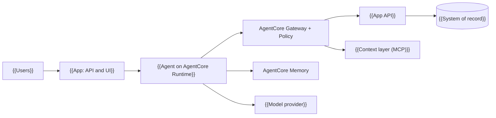

# Architecture: {{project_name}}

> Use when: designing or reviewing the architecture of an AI or agentic system with the developer, or recording it for handover. It is the one document that says what runs where, who owns what and why.
> Fill with the developer; don't invent facts — leave TODO where unknown.

> Guidance: Fill the sections in order; each answer constrains the next. Start as simple as possible (one agent, few systems) and expect a redesign within a year. Record each significant choice as an ADR ([ADR.md](ADR.md)) and list it in section 14. Deployment defaults below are AWS Bedrock AgentCore as taught in the course (Oct 2026); re-check product names and limits before relying on them. Remove the `> Use when`, `> Fill` and `> Guidance` lines when done.

**Version:** {{version}} | **Owner:** {{owner}} | **Last reviewed:** {{date}} | **Status:** draft

## 1. System context

> Guidance: Draw only what exists or will be built now. Delete rows and boxes for components you are not adding yet, and list them in §13 as "not for now" with their trigger.

| External actor or system | Type | Interaction | Owner |
| --- | --- | --- | --- |
| {{actor}} | user / system / provider | {{what flows}} | {{owner}} |

## 2. Components and where each runs

| Component | Responsibility | Runs on | Owner |
| --- | --- | --- | --- |
| {{App API and UI}} | {{records, rules, approvals, screens}} | {{AWS Lambda behind a Function URL}} | {{team}} |
| {{Agent}} | {{decides, explains}} | {{AgentCore Runtime}} | {{team}} |
| {{Context layer}} | {{business definitions, rules, reference data as tools}} | {{its own MCP server, e.g. Lambda with IAM auth}} | {{data governance}} |
| {{Gateway}} | {{tools, auth, policy on every call}} | {{AgentCore Gateway}} | {{security team}} |
| {{Database}} | {{records and checkpoints}} | {{Postgres, e.g. Supabase}} | {{team}} |

Example (UnderCover): the app and dashboard on Lambda, the claim agent on AgentCore Runtime, the context layer on its own Lambda, records and checkpoints on Supabase, models from OpenRouter.

## 3. Agent or not

> Guidance: Business logic belongs in code. Use an agent only where the step needs judgment over unstructured input, and only for one of the five reasons to add a further agent: isolate context, an independent check, a different model for a step, parallel work, ring-fenced permissions. Start with one agent; add more when evals show they help.

| Step | Could plain code do it? | Decision (code / agent) | Why |
| --- | --- | --- | --- |
| {{step}} | {{yes/no}} | {{code / agent}} | {{reason}} |

Example (UnderCover): the payout calculation is code (in the Week 2 lab, a payout tool cut wrong decisions or amounts from 36 to 8 of 75 runs); reading the story against the wording is the agent.

## 4. Agent inventory

| Agent | Role | Model and effort | Tools | Autonomy | Identity and permissions | Owner |
| --- | --- | --- | --- | --- | --- | --- |
| {{agent}} | {{role}} | {{model, reasoning effort}} | {{tools}} | {{automatic / approval first / prohibited per action}} | {{IAM role, API key, user token}} | {{owner}} |

## 5. Sources of data and owners

> Guidance: Keep four sources apart, each with its own owner and rules for the agent.

| Source | Holds | Written by | Agent access | Reached through |
| --- | --- | --- | --- | --- |
| Gateway rules | {{limits, who may call which tool}} | {{security team}} | none; cannot change | {{every call}} |
| Context layer | {{data dictionary, glossary, rules, reference data, documents, each with source, owner, review date}} | {{business teams, data governance}} | read only | {{MCP tools via the Gateway}} |
| Memory | {{the agent's own notes, per user or customer}} | {{the agent}} | read and write | {{memory tools; namespace per actor}} |
| System of record | {{records, decisions, payments}} | {{the app and the agent}} | {{only the writes you list}} | {{the app's API}} |

Data boundaries (where may data go?): {{rules, e.g. one customer's data only for that customer's work}}

## 6. State and durability

| Question | Answer |
| --- | --- |
| Unit of work and thread | {{one thread per claim/ticket/case}} |
| Checkpointer and durability | {{LangGraph with a Postgres saver, durability "sync"}} |
| After a crash or restart | {{the node that was running starts again; the unit carries on, not as a new attempt}} |
| Idempotent side effects | {{each payment or write has a node of its own that checks the id first; never twice}} |
| How a stopped job is noticed | {{heartbeat every minute; stopped after N minutes of silence}} |
| One job at a time? | {{lock in the database, or concurrency cap N}} |

## 7. Human in the loop

| Action | Trigger or threshold | Who decides | What they see | Recorded | If no answer |
| --- | --- | --- | --- | --- | --- |
| {{action}} | {{amount, risk, low confidence}} | {{role}} | {{evidence, buttons: approve / edit / send back with a note}} | {{who, when, note}} | {{timeout, escalation}} |

> Guidance: Design the human's step: when to ask, what to show, what to record, and how to avoid decision fatigue. The pause is `interrupt()`; the answer resumes the graph, possibly in a new session.

Example (UnderCover): an approval over $1,000 pauses the claim; a handler signs it off (the app pays) or sends it back with a note (the agent decides again). No claim is decided or paid twice, even when a step runs again after a restart.

## 8. Evals

Summary of [EVAL_PLAN.md](EVAL_PLAN.md): success metric {{metric}}; sets {{evaluation, held-out, test}}; run {{when}}.

## 9. Security

Summary of [THREAT_MODEL.md](THREAT_MODEL.md).

| Agent | Private data | Untrusted content | External communication | Leg removed |
| --- | --- | --- | --- | --- |
| {{agent}} | yes/no | yes/no | yes/no | {{which leg is broken, how}} |

- Guardrail layers: {{model check on input/output; Gateway Policy; app-side limit; coded checks}}
- Identities: {{agent's API key held in AgentCore Identity; runtime IAM role; each user's own sign-in}}
- Secrets: {{where each lives; none in code or frontend settings}}

## 10. Observability

- Traces: {{tool, e.g. Langfuse; session per unit of work}}
- Recorded per unit of work: {{steps, tool calls, refusals, tokens, cost, time}}
- Logs and alarms: {{CloudWatch; what alerts, who is paged}}
- Where the user sees it: {{the item's page shows each step}}

## 11. Deployment

| Piece | Where (default as taught, Oct 2026) | How deployed | Config and secrets |
| --- | --- | --- | --- |
| App API and UI | {{Lambda behind a Function URL; Mangum adapter}} | {{zip package}} | {{env vars; DB through a transaction pooler}} |
| Context layer | {{Lambda, AWS_IAM auth, behind the Gateway}} | {{zip package}} | {{none}} |
| Gateway and Policy | {{AgentCore Gateway; app as OpenAPI target; context layer as target}} | {{console or SDK}} | {{credential provider}} |
| Agent | {{AgentCore Runtime; one session per job}} | {{`agentcore deploy`, zip build}} | {{settings from env; keys from AgentCore Identity}} |
| Memory | {{AgentCore Memory with strategies: semantic, preference, summary or episodic}} | {{SDK}} | {{namespace per actor}} |

Environments: {{laptop (dev) / staging / prod}}. Region: {{region}}. Run limits: {{idle timeout, max session length, rate limits}}.

> Guidance: A session ends after an idle timeout (60 seconds in the course setup) unless registered async work is running. Keep config in the environment, secrets in the vault, and say who may invoke the agent. Delete rows and boxes for components you are not adding yet, and list them in §13 as "not for now" with their trigger.

## 12. Cost model

| Item | Driver | Estimate | Limit and alert |
| --- | --- | --- | --- |
| Model calls | {{tokens in/out x price x calls per unit}} | {{$ per unit of work}} | {{budget per run, spend cap on the key}} |
| AWS services | {{Runtime, Gateway, Memory, Lambda, logs}} | {{$ per month}} | {{monthly budget, alert thresholds}} |
| Other | {{database, tracing, judge}} | {{$ per month}} | {{budget, alert}} |

Target cost per unit: {{$}} against the baseline {{human cost per unit}}.

## 13. Risks and open questions

> Guidance: Also list here, as "not for now" with the trigger that would bring each in, the components you left out of §1 and §11.

| # | Risk or question | Impact | Owner | Due |
| --- | --- | --- | --- | --- |
| 1 | {{TODO}} | {{impact}} | {{owner}} | {{date}} |

## 14. ADR index

| ADR | Title | Status | Date |
| --- | --- | --- | --- |
| 0001 | {{title}} | {{proposed/accepted/superseded}} | {{date}} |
